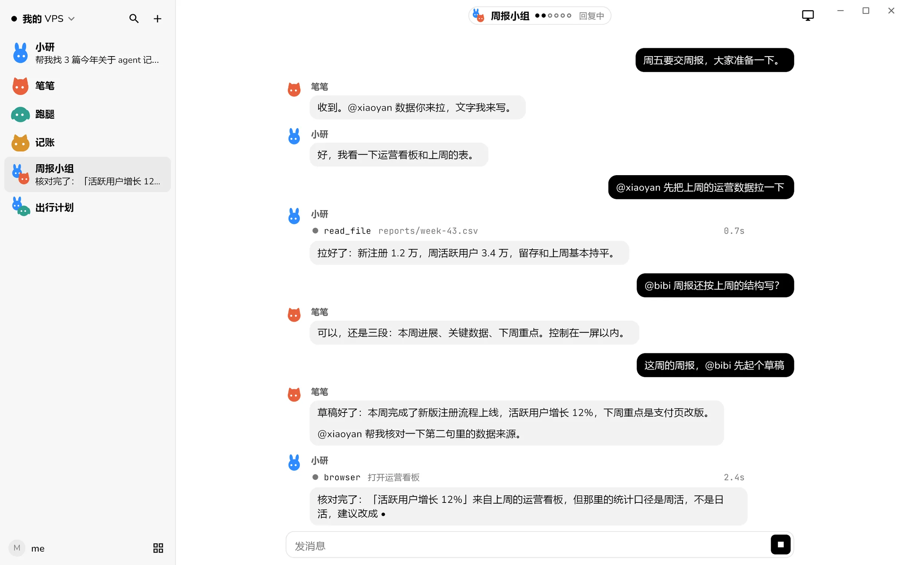
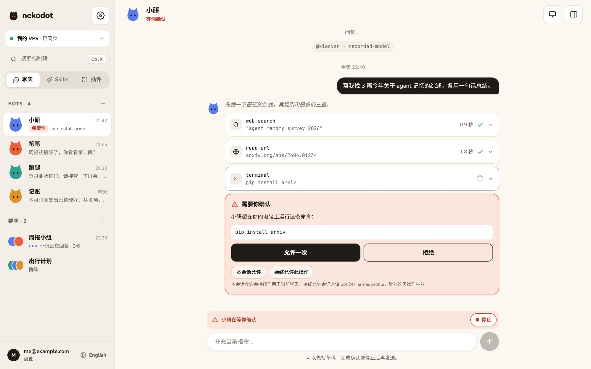
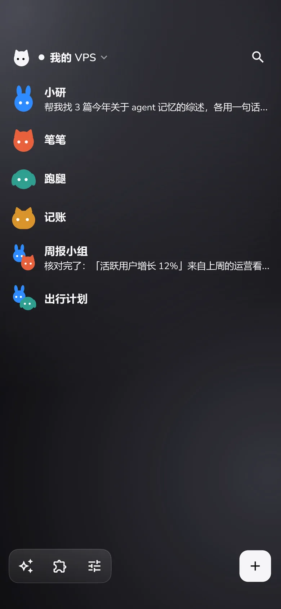
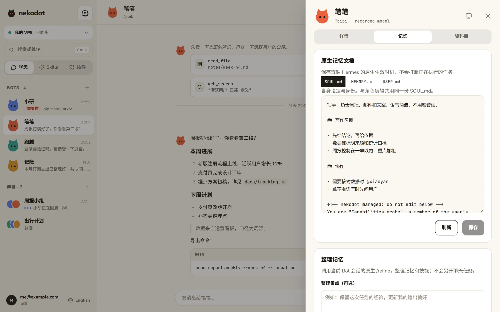

<p align="center">
  <picture>
    <source media="(prefers-color-scheme: dark)" srcset="docs/assets/nekodot-mark-dark.svg">
    
  </picture>
</p>

<h1 align="center">nekodot</h1>

<p align="center">
  <strong>把你的 AI 小队，带到自己的电脑上。</strong><br>
  组建一支各有专长的 Bot 团队，单独聊，或拉进群里接力协作。<br>
  它们运行在你自己的电脑或服务器上，由 <a href="https://hermes-agent.nousresearch.com">Hermes Agent</a> 驱动。
</p>

<p align="center">
  <a href="https://github.com/AR307/nekodot/actions/workflows/ci.yml"></a>
  
  <a href="https://nekodot.com/#start"></a>
</p>

<p align="center">
  <a href="https://nekodot.com">官网</a> ·
  <a href="https://nekodot.com/#start">下载</a> ·
  <a href="LICENSE">MIT License</a><br>
  <a href="#为什么是-nekodot">为什么是 nekodot</a> ·
  <a href="#功能">功能</a> ·
  <a href="#工作原理">工作原理</a> ·
  <a href="#快速开始">快速开始</a> ·
  <a href="#路线图">路线图</a>
</p>

<picture>
  <source media="(prefers-color-scheme: dark)" srcset="apps/site/assets/shots/desk-group-dark.webp">
  
</picture>

<p align="center"><sub>两位 Bot 在群里接力整理周报：一位起草，再交给另一位核对数据来源。截图使用演示数据。</sub></p>

> [!NOTE]
> 本页的界面和功能是 **0.2.0 候选版**（Flutter 客户端，`apps/native`），正在验收，尚未发布。官网当前提供的下载仍是 0.1.1 旧界面。

## 为什么是 nekodot

- **模型由你决定。** 用账号授权登录，或添加自定义 API。多个来源可以并存，每个 Bot 单独选来源和模型。
- **数据留在你的机器上。** 聊天记录、Bot 配置和完整密钥都保存在你自己的电脑或服务器。电脑只主动向外连接，不需要开放任何端口。
- **不用碰配置文件。** 复制一行命令接入电脑，之后的模型、Bot、技能和插件都在 App 里完成；节点自己更新。
- **不重新发明 agent。** 每个 Bot 就是一个原生 Hermes profile，记忆、技能和工具循环都由 Hermes 完成。nekodot 专注于易用的界面、多端连接和多 Bot 协作。

## 功能

| 能力               | 说明                                                                                       |
| ------------------ | ------------------------------------------------------------------------------------------ |
| **Bot 团队**       | 8 种形象、16 种颜色，设定名字、角色、来源和模型；创建后 Bot 用自己的模型先跟你打招呼。     |
| **私聊**           | 流式回复，看得见工具过程；需要确认的操作有审批卡片，拿不准时 Bot 会停下来问你。            |
| **群聊接力**       | 2–6 个 Bot 组成小组，用 `@handle` 指定谁来做；Bot 之间也能 `@` 对方交接工作。              |
| **模型来源**       | 由 Hermes 原生管理的账号授权与自定义 API；可查看上下文、最大输出和压缩记录。               |
| **记忆与自我改进** | 直接编辑 Bot 的原生记忆，一键调用 Hermes 整理经验；对你的了解在账号下的所有电脑间共享。    |
| **定时任务**       | 在聊天里让 Bot 安排任务，在 Bot 详情中查看计划与执行记录。                                 |
| **资料库**         | Bot 交付的文件统一收录，可预览、下载，或跳回当时的对话。                                   |
| **Skills 与插件**  | 浏览 Hermes 扩展目录，读完说明再装，按 Bot 启用和配置；也支持从 Git、本地目录或 ZIP 导入。 |
| **实时屏幕与接管** | 观看 Linux Bot 的独立浏览器与桌面；接管鼠标键盘，再交还给 Hermes。                         |
| **多电脑、多端**   | 一个账号连接多台电脑；Windows、Android 和网页看到同一份进度。                              |
| **节点自动更新**   | 校验发布签名，空闲时切换，新版本启动失败自动回滚；历史和 Hermes 资料不受影响。             |

### 两个平台，各有各的样子

<table>
  <tr>
    <td width="68%" valign="top"></td>
    <td valign="top"></td>
  </tr>
  <tr>
    <td valign="top"><sub><b>Windows</b>：纯黑白，只有 Bot 有颜色。托盘常驻，单实例。</sub></td>
    <td valign="top"><sub><b>Android</b>：毛玻璃和悬浮底栏。</sub></td>
  </tr>
</table>

两端都是原生 Flutter 界面，屏幕用原生 RFB，不嵌网页。支持中文与英文、浅色与深色。

### 看得见、管得住的执行过程

对话里不只有回答，还有 Bot 正在做的事。

- **看见过程**：实时文本、工具的开始与完成、等待确认的状态集中呈现。
- **随时补充**：运行中发送的消息由 Hermes 原生 steer 并入当前回合，已经完成的工作不会白做。
- **该你拍板时**：遇到需要授权的操作，Bot 会停下等你确认；Hermes 原生提问也会在这里等你回答。
- **随时叫停**：一个按钮停止当前执行；在群里则是「全部停止」，清空待接力的队列。
- **回来接着看**：切换设备或网络恢复后，历史与当前运行状态自动同步。

### 把任务交给一个小组

群组可以包含 2–6 个 Bot，并指定一位主答。没有 `@` 任何人时由主答开始；`@` 了谁，就按顺序交给谁。

> 这周的周报，@bibi 先整理草稿；@xiaoyan 帮忙核对数据来源。

Bot 在回复里 `@` 其他成员，就会把工作接力下去。为了避免无限循环，每条消息最多连续执行 6 个 Bot 回合，到上限会暂停并提示你。同一个群内一次只运行一个 Bot，不同群可以同时工作。同一个 Bot 在私聊和群聊之间共享上下文，群里讨论过的事，私聊时它也记得。

### 每个 Bot 都有自己的积累

<picture>
  <source media="(prefers-color-scheme: dark)" srcset="apps/site/assets/shots/desk-memory-dark.webp">
  
</picture>

从 Bot 打开详情：

| 页面   | 可以做什么                                                                                                                   |
| ------ | ---------------------------------------------------------------------------------------------------------------------------- |
| 详情   | 角色、模型与压缩信息，定时任务的计划与执行记录。                                                                             |
| 记忆   | 查看和编辑 `SOUL.md`（自身设定）、`MEMORY.md`（长期经验）、`USER.md`（对你的了解）；「整理记忆」调用 Hermes 原生 `/refine`。 |
| 资料库 | 搜索、筛选它交付的文件；预览图片、PDF 和文本，下载，或回到来源消息。                                                         |

`USER.md` 的条目按 Hermes 原生格式在同账号的电脑间同步；`SOUL.md`、`MEMORY.md` 和会话留在各自的 Bot 上。交付的文件单独保存一份副本，原工作文件之后再改动，也不会影响已经交付的版本。

### 打开它的屏幕，亲自接手

Linux VPS 节点安装时加上 `--with-computer`，就能从私聊、Bot 详情或群聊打开该 Bot 的原生屏幕。每个 Bot 使用独立的浏览器资料；默认只读观看，点击「接管」后才发送鼠标和键盘输入。

「交还」释放 Hermes 原生控制权，不会自动重发任务；如果回合已经结束，在聊天中发送“继续”。关闭画面与停止聊天任务是独立操作。浏览器窗口的生命周期遵循 Hermes，持久浏览器资料不会因为关闭面板而清空。

屏幕目前支持 Linux VPS。手机真机接管仍待完整验收。

## 工作原理

```text
App（Windows / Android）或网页
      │  HTTPS · WebSocket
      ▼
   Relay ············ 账号、配对、在线状态与消息路由，不保存聊天内容
      ▲
      │  由节点主动连出，无需开放端口
      │
   Node ············· 你的电脑或服务器：聊天记录、Bot 配置、交付文件
      │  官方 CLI / API（仅本机 127.0.0.1）
      ▼
   Hermes ··········· 每个 Bot 一个独立 profile：会话、记忆、技能、插件
```

| 位置           | 保存什么                                                  |
| -------------- | --------------------------------------------------------- |
| App / 网页     | 只保存登录状态、语言等偏好；聊天内容从节点同步而来。      |
| Relay          | 账号与配对信息。消息和文件只经过它转发，不落盘。          |
| Node           | 聊天历史、运行记录、Bot 配置与交付文件。                  |
| Hermes profile | 该 Bot 的原生会话、记忆、技能、插件，以及托管的模型密钥。 |

App 本身不运行 Hermes。完整的模型密钥只保存在节点上，界面里永远只显示后四位。nekodot 不修改 Hermes，只通过官方 CLI 与 API 集成，Hermes 升级不需要改动 nekodot。

请注意：模型请求会发往你配置的模型服务商。nekodot 让数据留在你自己的机器上，但它不是离线运行，也没有端到端加密。

## 快速开始

> [!NOTE]
> nekodot 目前是**开发者预览版**。Windows 干净安装、Android 真机和后台通知的完整验收仍在进行。

### 用 App

1. **下载安装。** [Windows x64](https://nekodot.com/downloads/nekodot-windows-x64.exe)（Windows 10 / 11，未做 Authenticode 签名）或 [Android arm64](https://nekodot.com/downloads/nekodot-android-arm64.apk)（Android 10+，已签名）。
2. **用邮箱注册。** 注册不会取得其他账号的服务器访问权。
3. **配对你的服务器。** 复制 App 生成的一行命令，在 **Linux x64** 或启用了 systemd 的 **WSL2 Ubuntu 24.04** 上运行。安装器把独立的 Node 24、Hermes 和节点服务装进 `~/.nekodot`，不改动系统环境。
4. **添加模型来源。** 在设置里用账号授权登录，或填写自定义 API 的名称、地址和 Key。
5. **创建 Bot。** 起个名字，选好形象、来源和模型，写一句它负责什么。需要协作时，再建一个群。

更新节点：新版节点会自己更新。从 `1.0.0` 旧节点升级时，App 会显示一次手动更新命令，复制到服务器运行即可。

### 自行部署

- 一台可以 SSH 登录的 **Linux x64** 服务器（推荐 Ubuntu 24.04），装有 Docker，用来运行 Relay。Bot 也可以直接跑在这台服务器上。
- 本机安装 **Node 24 LTS**、**pnpm 10.34.5** 和 OpenSSH 客户端。

构建 Relay 镜像，上传到服务器后 `docker compose up -d`，详见 [部署文档](deploy/README.md)。然后用网页连接：

```sh
git clone https://github.com/AR307/nekodot.git
cd nekodot
pnpm install --frozen-lockfile
pnpm dev:remote --ssh <your-ssh-alias>
```

它通过 SSH 隧道连接远端 Relay，并在浏览器中打开 http://127.0.0.1:4318。加上 `--lan`，同一局域网内的手机也能访问。只想在本机跑起来看看、或参与开发，请看 [开发说明](docs/development.md)。

## 开发

技术栈：Flutter · Rust · React 19 · TypeScript · Tailwind CSS v4 · Fastify · WebSocket · node:sqlite · Zod · Hermes Agent

```sh
pnpm install --frozen-lockfile
pnpm lint && pnpm typecheck && pnpm test
pnpm build
pnpm test:e2e
pnpm native:analyze && pnpm native:test
```

自动化测试使用录制的真实 Hermes 事件回放，不调用付费模型。本地运行、远程 Relay 调试、节点数据位置与测试策略见 [开发说明](docs/development.md)。Flutter 客户端的构建与验收范围见 [原生客户端记录](docs/side-phase-3-native-product.md)；旧 Tauri 客户端见 [客户端说明](docs/client-development.md)。

```text
apps/native            Flutter Windows / Android 客户端（候选）与原生 RFB 屏幕
apps/web               React 网页与同步逻辑
apps/client            Tauri 2 Windows / Android 宿主（已发布的 0.1.x）
apps/site              双语静态官网
apps/relay             账号、配对、WebSocket 路由、文件转发与节点发布通知
apps/node              节点：持久化、Hermes 接入、群聊路由与自动更新
packages/protocol      共享协议与 Zod schema
packages/tauri-plugin-nekodot Android FCM、生命周期与文件分享桥接
packages/fake-hermes   测试专用：回放录制的真实 Hermes 事件
deploy                 Relay 镜像、节点安装器与系统服务
design                 原始视觉参考与九块设计画板
docs                   开发说明、Hermes 调研、实施记录与截图
```

## 路线图

- [x] 私聊：流式回复、工具过程、审批、原生提问、运行中补充指令、停止
- [x] 群聊：`@` 指定成员、Bot 之间接力、接力上限
- [x] 一行命令接入电脑（Linux x64 / WSL2），多端同步与断线恢复
- [x] Bot 详情：原生记忆、定时任务、资料库
- [x] Skills 与插件中心
- [x] 实时画面与接管：Linux VPS 原生浏览器、桌面与人工接管
- [x] 多模型来源：账号授权与自定义 API，每个 Bot 单独选择
- [x] 同账号共享用户记忆
- [x] 节点签名更新与自动回滚
- [x] Flutter Windows / Android 客户端
- [ ] 0.2.0 发布：Windows 干净安装、Android 真机、后台通知验收
- [ ] PWA：添加到手机主屏幕
- [ ] macOS 与 ARM 节点

## 致谢

- [Hermes Agent](https://hermes-agent.nousresearch.com)（Nous Research）：每个 Bot 背后的 agent 引擎。
- 界面字体 [Nunito](https://fonts.google.com/specimen/Nunito) 与 [JetBrains Mono](https://www.jetbrains.com/lp/mono/)，以 SIL Open Font License 1.1 授权。

## 许可证

采用 [MIT License](LICENSE)。第三方字体与依赖保留各自的许可证。
