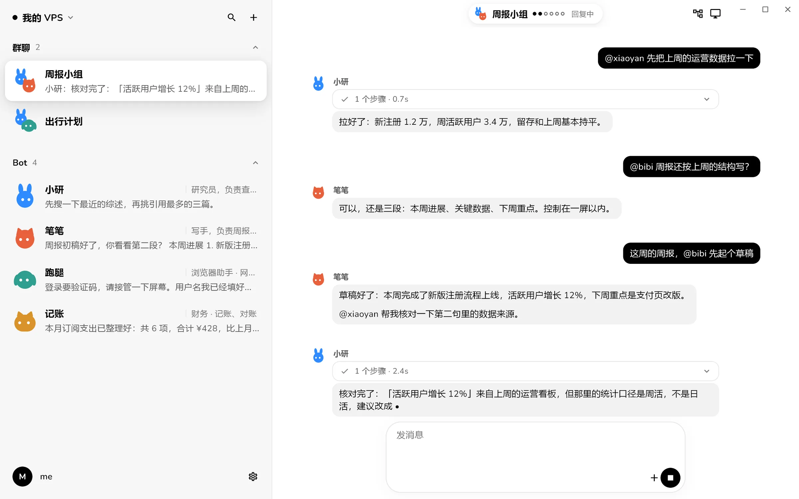

<p align="center">
  <picture>
    <source media="(prefers-color-scheme: dark)" srcset=".github/assets/nekodot-mark-dark.svg">
    
  </picture>
</p>

<h1 align="center">nekodot</h1>

<p align="center">
  <strong>一群替你干活的 Bot，装在你自己的电脑上。</strong><br>
  查资料、写周报、记账、填网页，各交给一个 Bot。它们用这台电脑上的文件和浏览器干活，<br>
  在群里互相接力，动手之前先问你。每个 Bot 都是一个原生的 <a href="https://hermes-agent.nousresearch.com">Hermes Agent</a>。
</p>

<p align="center">
  <a href="https://github.com/AR307/nekodot/actions/workflows/ci.yml"></a>
  
  <a href="https://github.com/AR307/nekodot/releases/latest"></a>
</p>

<p align="center">
  <a href="https://nekodot.com">官网</a> ·
  <a href="https://nekodot.com/#start">下载</a> ·
  <a href="LICENSE">MIT License</a><br>
  <a href="#它能做什么">它能做什么</a> ·
  <a href="#功能一览">功能一览</a> ·
  <a href="#工作原理">工作原理</a> ·
  <a href="#快速开始">快速开始</a> ·
  <a href="#路线图">路线图</a>
</p>

<picture>
  <source media="(prefers-color-scheme: dark)" srcset=".github/assets/desk-group-dark.webp">
  
</picture>

<p align="center"><sub>周报小组里，笔笔写完草稿后 @小研 核对数据来源。截图使用演示数据。</sub></p>

> [!NOTE]
> 正式版采用 Flutter 原生客户端（`apps/native`），各版本的更新内容见 [Releases](https://github.com/AR307/nekodot/releases)。截图取自当前源码，界面细节可能比最新正式版新。

## 它能做什么

### 几个 Bot 一个群，接力把事做完

群里放 2 到 6 个 Bot，各管一摊，并指定一位主答。没有 `@` 任何人时由主答开始；`@` 了谁，就交给谁。

> 这周的周报，@bibi 先起个草稿

笔笔写完，会在回复里 `@xiaoyan` 去核对数据，你只看最后的结果。中途想改要求，直接在群里说。

- 一个群一次只有一个 Bot 在干活，不同的群可以同时干。
- 每条消息最多连续接力 6 轮，到了就停下来等你，不会无限循环。
- 同一个 Bot 在私聊和群里共用上下文，群里聊过的事，私聊时它也记得。

### 装在你自己的电脑上

在 Windows 上添加电脑时选「这台电脑」，App 会自己把 Node、Hermes 和依赖装进你选的目录，不用另外租服务器。Bot 直接读写这台电脑上的文件，比如把 `D:\报销\10月` 里的发票汇总成一张表。想让 Bot 全天在线，也可以装在一台 Linux 服务器上。

电脑只向外连接，不用开放端口。每样东西具体存在哪，见[工作原理](#工作原理)。

### 动手之前，先问你

它要跑命令、改文件时，会停下来等你选：允许一次、本会话允许、总是允许，或者拒绝。用了哪个工具、花了几秒，对话里一条条列着。

- 干到一半想补一句，直接发。消息由 Hermes 原生 steer 并入当前回合，做完的不白做。
- 方向不对就按停止；群里是「全部停止」，同时清空待接力的队列。
- 拿不准的地方，它会用 Hermes 原生提问停下来问你。
- 换设备或网络恢复后，历史和运行状态自动同步。

### 人不在电脑前，用手机管着

Android App 连的是同一台电脑，聊天和进度两边一样。Bot 回复了、有问题问你、等你确认，手机都会收到通知，点开就能放行或者拒绝。

### 它还会这些

| 能力             | 说明                                                                                                                                                          |
| ---------------- | ------------------------------------------------------------------------------------------------------------------------------------------------------------- |
| **打开它的屏幕** | Linux 服务器上的 Bot 有独立的浏览器和桌面。默认只看；碰到验证码，点「接管」自己填，填完交还。安装节点时加 `--with-computer`。                                 |
| **操作这台电脑** | Windows 上可以单独允许某个 Bot 用鼠标键盘操作你的桌面，默认关闭，按审批设置确认。                                                                             |
| **记忆你能改**   | `SOUL.md`（自身设定）、`MEMORY.md`（长期经验）、`USER.md`（对你的了解）都能直接编辑；「整理记忆」调用 Hermes 原生 `/refine`。`USER.md` 在同账号的电脑间同步。 |
| **技能与插件**   | 浏览 Hermes 的扩展目录，先看说明再装，按 Bot 启用和配置；也能从 Git、本地目录或 ZIP 导入。                                                                    |
| **保密交付**     | Bot 要 API 密钥或密码时，会在聊天里弹出加密输入框。只有提出请求的 Bot 能用，可以选择保存以便同一用途再用，聊天记录里看不到原文。                              |
| **定时任务**     | 在聊天里让 Bot 安排定时或 Webhook 任务，在 Bot 详情里看计划和执行记录。                                                                                       |
| **资料库**       | Bot 交付的文件单独存一份，可以预览、下载，或跳回当时的对话。                                                                                                  |

## 功能一览

| 方面            | 说明                                                                                                                    |
| --------------- | ----------------------------------------------------------------------------------------------------------------------- |
| **Bot**         | 起名字、选形象和颜色、写一句它负责什么，选模型来源和模型；创建后它用自己的模型先跟你打招呼。                            |
| **模型来源**    | 账号授权登录或自定义 API，由 Hermes 原生管理；多个来源并存，每个 Bot 单独选。                                           |
| **Hermes 设置** | Hermes 的原生设置都能在 App 里改，不用碰配置文件。                                                                      |
| **多台电脑**    | 一个账号连接多台电脑，随时切换；Windows、Android 和网页看到同一份进度。                                                 |
| **节点更新**    | 校验发布签名，空闲时切换，新版本启动失败自动回滚；历史和 Hermes 资料不受影响。                                          |
| **客户端**      | Windows 与 Android 原生 Flutter 界面，黑白配色，只有 Bot 头像有颜色；屏幕用原生 RFB，不嵌网页。中文与英文，浅色与深色。 |

nekodot 不重新发明 agent：每个 Bot 就是一个原生 Hermes profile，记忆、技能和工具循环都由 Hermes 完成。nekodot 只做界面、连接和多个 Bot 之间的协作，也不修改 Hermes。

## 工作原理

```text
App（Windows / Android）或网页
      │  HTTPS · WebSocket
      ▼
   Relay ············ 账号、配对、在线状态与消息路由，不保存聊天内容
      ▲
      │  由节点主动连出，无需开放端口
      │
   Node ············· 你的电脑或服务器：聊天记录、Bot 配置、交付文件
      │  官方 CLI / API（仅本机 127.0.0.1）
      ▼
   Hermes ··········· 每个 Bot 一个独立 profile：会话、记忆、技能、插件
```

| 位置           | 保存什么                                                  |
| -------------- | --------------------------------------------------------- |
| App / 网页     | 只保存登录状态、语言等偏好；聊天内容从节点同步而来。      |
| Relay          | 账号与配对信息。消息和文件只经过它转发，不落盘。          |
| Node           | 聊天历史、运行记录、Bot 配置与交付文件。                  |
| Hermes profile | 该 Bot 的原生会话、记忆、技能、插件，以及托管的模型密钥。 |

App 本身不运行 Hermes。完整的模型密钥只保存在节点上，界面里永远只显示后四位。nekodot 不修改 Hermes，只通过官方 CLI 与 API 集成，Hermes 升级不需要改动 nekodot。

请注意：模型请求会发往你配置的模型服务商。nekodot 让数据留在你自己的机器上，但它不是离线运行，也没有端到端加密。

## 快速开始

> [!NOTE]
> 最新版本见上方 release 徽章。Windows 本机运行和 Android 模拟器已用真实模型验收；Android 真机与 macOS / Linux 桌面的验收范围见各版本的更新说明。

### 用 App

1. **下载安装。** [Windows x64](https://github.com/AR307/nekodot/releases/latest/download/nekodot-windows-x64.exe)（Windows 10 / 11，未做 Authenticode 签名）或 [Android arm64](https://github.com/AR307/nekodot/releases/latest/download/nekodot-android-arm64.apk)（Android 10+，已签名）。
2. **用邮箱验证码注册。** 登录继续使用密码；旧账号首次重新登录需补验邮箱，原节点和历史保留。注册不会取得其他账号的服务器访问权。
3. **给 Bot 找一台电脑。** 在 Windows 上添加电脑时选「这台电脑」，App 自动准备独立的 Node 与 Hermes，并配对启动。想全天在线，就复制 App 生成的一行命令，在 **Linux x64** 或启用了 systemd 的 **WSL2 Ubuntu 24.04** 上运行；安装器把独立的 Node 24、Hermes 和节点服务装进 `~/.nekodot`，不改动系统环境。
4. **添加模型来源。** 在设置里用账号授权登录，或填写自定义 API 的名称、地址和 Key。
5. **创建 Bot。** 起个名字，选好形象、来源和模型，写一句它负责什么。需要协作时，再建一个群。

更新节点：新版节点会自己更新。从 `1.0.0` 旧节点升级时，App 会显示一次手动更新命令，复制到服务器运行即可。

### 自行部署

- 一台可以 SSH 登录的 **Linux x64** 服务器（推荐 Ubuntu 24.04），装有 Docker，用来运行 Relay。Bot 也可以直接跑在这台服务器上。
- 本机安装 **Node 24 LTS** 和 **pnpm 10.34.5**，用来构建 Relay 与节点发布包。

构建 Relay 镜像，上传到服务器后 `docker compose up -d`，再让 App 连接你的 Relay 地址。完整步骤见 [部署文档](deploy/README.md)。

## 开发

技术栈：Flutter · Rust · TypeScript · Fastify · WebSocket · node:sqlite · Zod · Hermes Agent

```sh
pnpm install --frozen-lockfile
pnpm lint && pnpm typecheck && pnpm test
pnpm build
pnpm native:analyze && pnpm native:test
```

自动化测试回放 `tests/fixtures` 里录制的真实 Hermes 事件，不调用付费模型。Flutter 客户端的结构与构建见 [apps/native](apps/native/README.md)。

```text
apps/native            Flutter Windows / Android 产品客户端与原生 RFB 屏幕
apps/relay             账号、配对、WebSocket 路由、文件转发与节点发布通知
apps/node              节点：持久化、Hermes 接入、群聊路由与自动更新
packages/protocol      共享协议与 Zod schema
packages/fake-hermes   测试专用：回放录制的真实 Hermes 事件
deploy                 Relay 镜像、节点安装器与系统服务
scripts                构建、打包、发布与录制 Hermes 事件的脚本
tests                  测试辅助与录制的 Hermes 事件
```

## 路线图

- [x] 私聊：流式回复、工具过程、审批、原生提问、运行中补充指令、停止
- [x] 群聊：`@` 指定成员、Bot 之间接力、接力上限
- [x] 一行命令接入电脑（Linux x64 / WSL2），多端同步与断线恢复
- [x] Bot 详情：原生记忆、定时任务、资料库
- [x] Skills 与插件中心
- [x] 实时画面与接管：Linux VPS 原生浏览器、桌面与人工接管
- [x] 多模型来源：账号授权与自定义 API，每个 Bot 单独选择
- [x] 同账号共享用户记忆
- [x] 节点签名更新与自动回滚
- [x] Flutter Windows / Android 客户端
- [x] 0.3.0 正式发布
- [x] Windows 本机运行：一键准备 Node 与 Hermes，Bot 可读写本机文件、可选操作桌面
- [x] 聊天内保密交付 API 密钥与密码
- [x] 0.3.1 正式发布
- [ ] Windows 干净用户安装、Android 真机与后台通知完整验收
- [ ] PWA：添加到手机主屏幕
- [ ] macOS 与 ARM 节点

## 致谢

- [Hermes Agent](https://hermes-agent.nousresearch.com)（Nous Research）：每个 Bot 背后的 agent 引擎。
- 界面字体 [Nunito](https://fonts.google.com/specimen/Nunito) 与 [JetBrains Mono](https://www.jetbrains.com/lp/mono/)，以 SIL Open Font License 1.1 授权。

## 许可证

采用 [MIT License](LICENSE)。第三方字体与依赖保留各自的许可证。
