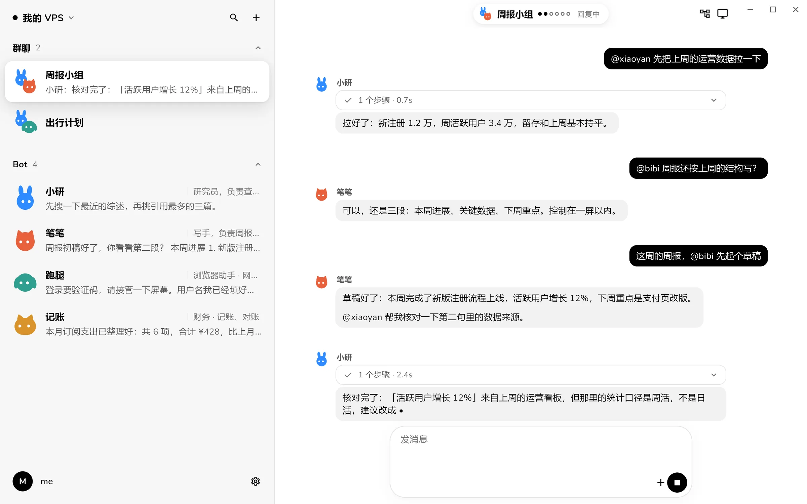

  <picture>
    <source media="(prefers-color-scheme: dark)" srcset=".github/assets/nekodot-mark-dark.svg">
    
  </picture>

<h1 align="center">nekodot</h1>

  <strong>你的新一代个人 AI 助手。</strong> 
  用你自己的模型，在你自己的电脑上工作，Windows 和 Android 都能找到它。 
  让 Dot 查资料、处理文件、操作浏览器，也可以做一个随时打开的小工具。

  
  

  <a href="README.md">English</a> · 简体中文 
  <a href="https://www.nekodot.com">官网</a> ·
  <a href="https://www.nekodot.com/zh/#start">下载</a> ·
  <a href="deploy/README.md">自行部署</a> ·
  <a href="LICENSE">MIT License</a>

<picture>
  <source media="(prefers-color-scheme: dark)" srcset=".github/assets/desk-group-dark.webp">
  
</picture>

原生客户端，使用演示账号。

## 和你的 Dot 说

把任务交给 Dot，它可以检索、浏览网页、读写文件、运行工具，再把结果交给你。需要委派工作时，你仍然和这个 Dot 对话，由它整理结果，有必要再在聊天里向你提问。

审批和提问直接出现在对话里。执行中可以补充要求、排队下一条消息，或停止当前任务。活动状态固定在输入框上方；Flow 展示当前或最近一次任务的真实步骤。

需要团队协作时，创建群聊，指定主答 Dot，并给成员分工。可以 `@` 指定成员或使用 `@everyone`，Dot 之间也能接力。一个群一次运行一个 Dot，连续接力六轮后暂停。

## 做一个空间

记账本、单词卡、出行清单，告诉 Dot 你需要什么，它会做成带有独立图标的页面，放进「空间」。从预览图库打开，在电脑或手机上使用；想调整就接着和 Dot 说。

空间记录通过你的 Node 同步。已经下载的页面和缓存记录可以离线打开；需要访问远程服务的功能仍需联网。

## 功能一览

| 方面       | 功能                                                                                |
| ---------- | ----------------------------------------------------------------------------------- |
| 模型       | 每个 Dot 分别选择模型来源和模型，使用模型目录及支持的思考等级。                     |
| 文件       | 附加文件和图片，在 App 内阅读 Markdown、PDF 和支持的 Office 文档。                  |
| 插件中心   | 管理 Skills、插件、MCP 和账号连接器；连接器访问须经你授权。                         |
| 记忆       | 编辑 Dot 的记忆和指令；账号级用户记忆可在自己的电脑间共享。                         |
| 例行任务   | 定时或通过 Webhook 触发，查看运行记录，并接着结果追问。                             |
| 保密交付   | 用聊天中的加密卡片提交凭据，Dot 收到引用；保存的凭据仅供该 Dot 在已确认用途下使用。 |
| 屏幕       | 查看和接管支持的 Linux 浏览器或桌面；Windows 桌面操作按 Dot 单独开启。              |
| 统计       | 使用日历、输入输出与缓存 Token、会话和任务占比，以及 CSV 导出。                     |
| 原生客户端 | Windows 与 Android、浅深色、中英文、桌面侧栏和手机导航。                            |

## 开始使用

1. 安装 [Windows x64](https://github.com/AR307/nekodot/releases/latest/download/nekodot-windows-x64.exe) 或 [Android arm64](https://github.com/AR307/nekodot/releases/latest/download/nekodot-android-arm64.apk)。
2. 注册、验证邮箱并登录。
3. 连接电脑。Windows 选择「这台电脑」安装托管运行环境；Linux x64 服务器或启用 systemd 的 WSL2 Ubuntu 使用 App 提供的配对命令。
4. 添加模型来源，选择模型，创建 Dot。
5. 开始对话、创建空间，或建群协作。

运行 Dot 的电脑需要保持开机。Node 主动连接 Relay，不需要给这台电脑开放入站端口。手机通知受系统权限和后台投递影响。

正式安装包支持 Windows 10/11 x64 和 Android 10+ arm64。Android APK 已签名，Windows 安装器未做 Authenticode 签名。Android 真机、macOS/Linux 桌面仍待验，具体范围见各版本[发布说明](https://github.com/AR307/nekodot/releases)。

## 工作原理

    Flutter App（Windows / Android）
        │ HTTPS / WebSocket
        ▼
      Relay — 账号、配对、路由、用量统计和更新
        ▲ Node 主动连出
      Node — 聊天记录、文件、空间、Dot 设置和群聊协作
        │ 本机管理 API 和 canonical WebSocket
      Hermes — 每个 Dot 独立的 profile

Hermes 负责模型和工具循环、原生会话、记忆和扩展；nekodot 负责界面、连接与协调，不另建 Agent 执行引擎。托管运行环境保持 Hermes v0.22.6 / v0.22.6-r3。

App 保存登录状态、偏好和本地缓存；Relay 保存账号、配对和用量元数据，转发聊天与文件；Node 和 Hermes profiles 保存会话、交付文件、空间记录和凭据。

模型请求会发往你选择的服务商。普通聊天没有端到端加密，保密卡片采用单独的加密交付。官网为 **www.nekodot.com**；API、WebSocket、安装和下载入口为 **api.nekodot.com**。

## 开发与自行部署

客户端使用 Flutter；服务端使用 TypeScript、Fastify、WebSocket 和 SQLite。构建需要 Node 24 与 pnpm 10.34.5：

    pnpm install --frozen-lockfile
    pnpm lint && pnpm typecheck && pnpm test
    pnpm build
    pnpm native:analyze && pnpm native:test

详见[原生客户端](apps/native/README.md)与[Relay 部署](deploy/README.md)。

    apps/native          Flutter 客户端与原生平台接入
    apps/relay           账号、配对、路由、用量与版本
    apps/node            持久化、Hermes 接入与协作
    packages/protocol    共享协议与数据校验
    packages/fake-hermes 测试专用事件回放
    third_party          原生文档预览依赖与许可
    deploy               镜像、安装器与服务定义
    scripts              构建、打包与发布工具
    tests                测试辅助与录制事件

组件测试与回放只辅助真实客户端验收，不代表模型或设备行为已经通过。

## 致谢与许可证

- [Hermes Agent](https://hermes-agent.nousresearch.com)（Nous Research）为 Dot 提供执行能力。
- [Nunito](https://fonts.google.com/specimen/Nunito) 与 [JetBrains Mono](https://www.jetbrains.com/lp/mono/) 采用 SIL Open Font License 1.1。
- [Material Symbols](https://fonts.google.com/icons) 采用 Apache License 2.0。
- 原生 Office 预览依赖见[第三方说明](third_party/README.md)。

[MIT License](LICENSE)。第三方依赖保留各自的许可证。
