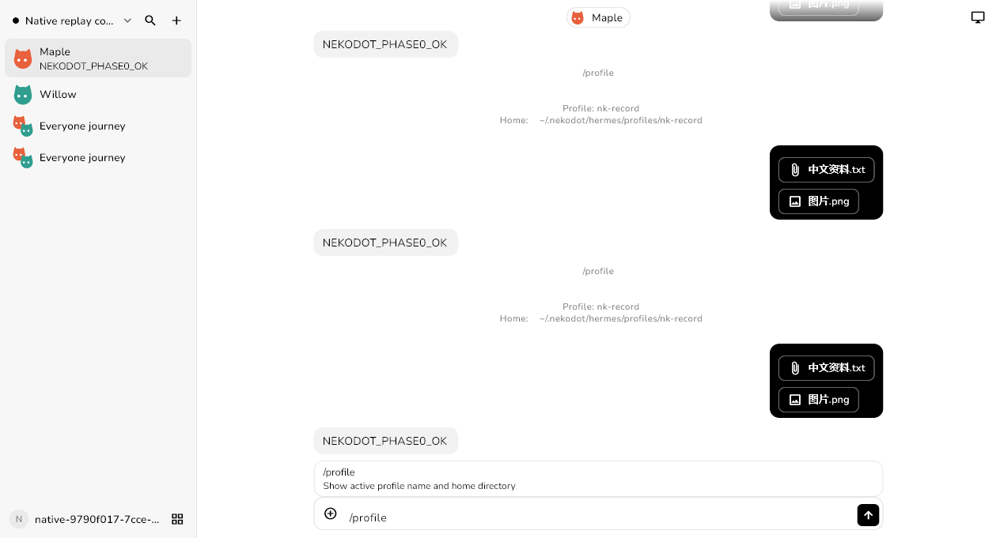
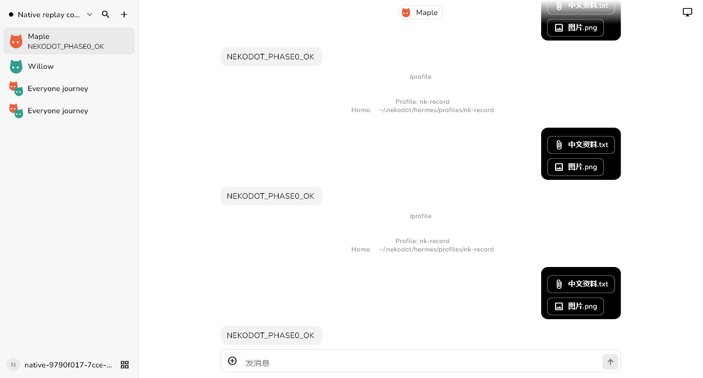
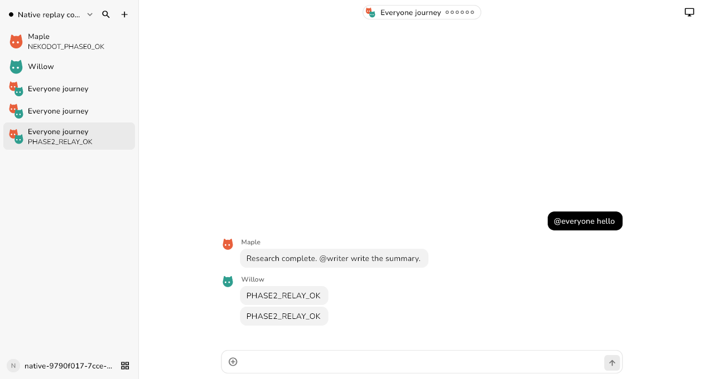

# 原生客户端：窗口、指令栏、群提及与附件

2026-11-01。本轮是现有产品的本地候选更新，不替换公开安装包，不部署或推送。

## 实现范围

### Windows 登录窗口

- 登录/注册页顶部新增 44px 原生拖动区域，放在表单滚动层之上；语言按钮避开窗口控件。
- 使用现有 window_manager 的 DragToMoveArea，不增加自定义窗口机制。
- Flutter 手势确认实际调用 startDragging，表单输入正常；隔离 Windows 窗口双击标题区可最大化、还原。Computer Use 拖动没有取得实际位移证据，**真实鼠标拖动仍待人工复核**，不能把手势测试写成完整实窗验收。

### Hermes 原生命令

- 输入开头的 `/` 展示目标 profile 的 commands.catalog，可搜索描述与选择命令；群聊可选择执行成员。
- 通过原生 session.resume、slash.exec / command.dispatch 执行；原生返回的任务指令继续走现有 Runs API，不另建 agent。使用已有 Operations 显示耗时命令结果，失败保留草稿。
- 每个 Bot 保持原 profile 身份。仅终端命令明确不可用；`/new`、`/reset`、`/branch`、`/fork`、`/resume`、`/sessions`、`/undo`、`/retry` 需要原生会话界面，本轮禁用并说明原因。不能修改另一个 CLI worker 的 session 后假称产品会话已切换。
- 原生命令与该 Bot 的当前 run 不并行修改会话；正在执行任务时仍使用既有补充指令和停止入口。
- 实际节点读取到 150 个目录条目，执行 `/profile` 并取得 `/plan` 原生指令响应；脱敏目录及响应见 `docs/fixtures/commands-native.json`。该资料是原生接口录制，不是模型成功回复。

### 群聊 @everyone

- 在提及所在位置展开当前群成员，按顺序去重；保留现有成员快照、串行接力和最多 6 回合规则。
- Flutter 与 Web 的成员选择器均增加“所有成员”。不是开启多个并行 agent，也不改变 Hermes 执行方式。

### 发送文件与图片

- Flutter 使用系统文件选择器；复用经过认证的 Relay 分块上传与节点出站连接，不新增公网文件服务。
- 支持文件单独发送、文字加文件、中文文件名和多个待发送附件；显示进度、移除草稿附件、历史文件卡和现有预览/保存入口。
- Node 保存交付副本，将文件复制到实际 Bot profile 的 uploads，并将明确路径交给 Hermes；PNG/JPEG/WebP/GIF 同时使用原生 image_url 输入。文档读取和视觉理解仍交给 Hermes，不自行解析或假造模型回复。
- 用户附件不混入 Bot 发出的资料库；消息与附件绑定同事务落库，clientMsgId 重试不重复启动模型任务。发送成功后即使离开会话也清理已发送的附件草稿，不清除后来写的新指令。
- 原生 steer 当前只接收文本。运行中带附件发送会明确报错并保留附件；等待回合结束或停止后再发送，不静默丢文件或另开并行任务。
- Web 可查看新增用户文件卡；本轮上传按钮和 `/` 指令栏针对 Flutter 产品客户端，未为旧 Web 入口另做一套。

## 验收结果

| 检查                     | 实际结果                                                                                             |
| ------------------------ | ---------------------------------------------------------------------------------------------------- |
| Node 24 lint / typecheck | 通过                                                                                                 |
| 服务端测试               | 27 文件、41 项通过                                                                                   |
| Flutter analyze / test   | 通过；14 项测试通过                                                                                  |
| Node、Relay、Web 构建    | 通过；Web 保留既有大 chunk 提示                                                                      |
| Windows 原生完整旅程     | 原生 UI + 产品 Node/Relay + 实际 Hermes 录制，执行命令、文件单独发送/预览、建群与 @everyone 通过     |
| Edge 回归                | 初次整批 6 项通过、提供方旅程超时；该旅程独立复测通过（14.7 秒）。未将首次超时隐藏或宣称整批一次全绿 |
| Windows release          | 构建通过；未生成新发布安装器                                                                         |
| Android arm64 release    | 构建通过；APK 验证为单个签名者、v2 签名有效                                                          |
| Android 真机             | 未在本轮验收文件选择或新指令栏，不以 Windows 旅程代替                                                |

Windows 旅程截图：

### 真实模型：文件与图片

在实际 Linux 节点的隔离原生 session 中，使用所选 Bot profile、已有真实模型配置和候选 FileLibrary 输入，发送：

- 中文文件名的 UTF-8 文档，含随机无害标记；
- 自生成图片，左边红色方块、右边蓝色圆形。

原生 run 完成，回复命中文件中的精确标记，并正确识别图形、颜色和左右位置。脱敏结果见 `docs/evidence/composer-real-files.json`。这证明实际读取与视觉识别，不只是回放传输正确；但**不是新版 App 到生产 Node 的部署验收**。没有恢复或重放既有用户任务，没有修改记忆配置或其他服务。

## 保留边界

- 小内存 VPS 的屏幕资源调查单独见 `docs/screen-memory-investigation.md`；没有把未启动的屏幕写成修复成功。
- Edge 原生 Linux 屏幕专项未在这次回归运行。旧截图与其他未提交 UI 改动保持原样；本轮截图使用新的 composer-native 文件名。
- 私有验收目录和原始模型资料保留，不提交密钥、端点、SSH 目标或原始私有日志。
- 本地候选输出为 `apps/native/build/windows/x64/runner/Release/` 与 `apps/native/build/app/outputs/flutter-apk/app-release.apk`。Windows 运行需保留完整目录，不能只复制 EXE。
- 新增 RPC 需要服务端与客户端一起更新后才能对外使用。本轮只本地提交，未替换线上 Relay、Node 或公开下载，也未改变版本号。
