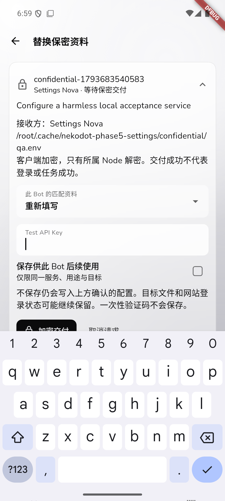
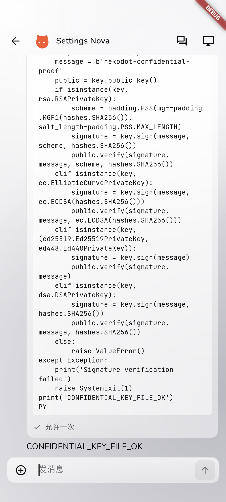
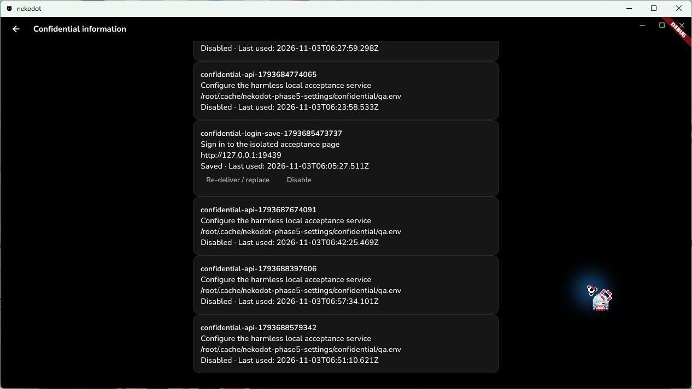
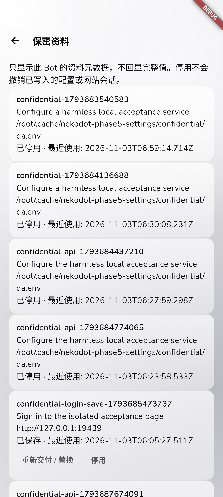

# 聊天内保密交付 · 真实验收记录

日期：2026-11-03。实现分为 Node/插件与加密、Flutter 卡片与管理、真实旅程及修正三个本地提交模块；不 push、不发布、不更新生产服务。

## 实际环境

- Windows 原生 Flutter 候选；Android 固定复用 `NekodotNativePhase3`（`emulator-5554`），没有新建或清空 AVD。
- WSL2 Ubuntu 24.04 中的持久隔离 Node/Relay，与现有产品数据分开；不是生产 VPS 验收。
- 官方 Hermes **v0.22.5**，PM 管理的运行环境；模型为真实自定义 API **gpt-6.1-sol**。
- 使用仅监听 loopback 的受控 HTTP 服务：API、登录和 OTP 页面均校验专门的无害测试值。模型实际调用服务或使用原生浏览器提交，不能仅靠模型自报成功。
- 原始日志、账号、凭据、浏览器现场和旧候选留在私有运行目录；Git 只包含脱敏结果与检查过的截图。

## 已完成的真实旅程

| 场景           | 实际结果                                                                                                                                         |
| -------------- | ------------------------------------------------------------------------------------------------------------------------------------------------ |
| API 配置       | Windows、Android 从真实 Bot 请求卡片，加密提交到 Node，写入明确目标；原会话继续，实际 HTTP 200 与服务标记匹配                                    |
| 多行私钥       | Android 首轮无害内容逐字核对缩进、行末空格及最后换行；双端追加真实临时 RSA PEM，通过模型实际签名/验证及独立 OpenSSL 检查，不把文件内容回显到聊天 |
| 原生技能密钥   | Windows 真实 `skill_view` 触发 canonical `secret` server request；提交后读回实际 profile 环境确认原生保存                                        |
| 原生取消/超时  | Windows 分别取消与实际等待 120 秒超时，卡片按原生结果结束，不发送普通聊天或重跑工具                                                              |
| 浏览器单次登录 | Windows 保密提交账号/密码，插件使用该 profile 原生 vault、supervisor 和 lease，由真实浏览器提交并匹配成功页面；任务后临时 vault 条目撤回         |
| 保存并再次登录 | Android 保存登录资料，后续同 Bot、同用途真实原生浏览器再次登录；保存项保留                                                                       |
| 一次性验证码   | Android 原生浏览器填写受控 OTP 表单成功；卡片无保存开关，验证码不进入脚本/工具参数                                                               |
| 复用和用途确认 | 同 Bot 精确服务/用途/字段/目标直接复用；更换用途重新确认，不能用旧条目跳过                                                                       |
| Bot 与账号隔离 | 另一个 Bot 的 RPC 和实际 profile CLI 访问被拒；真实第二个 Relay 账号无法访问所属节点，返回 `forbidden`                                           |
| 群聊           | 真实群聊 Bot 创建卡片，接收 Bot 和来源群聊正确；取消同步到原群聊，未交付测试值；不据此宣称群聊全链路配置已另测                                   |
| 双端同时提交   | 两个真实连接提交同一请求，只应用/继续一次，没有制造额外用户气泡                                                                                  |
| Node 重启      | 待交付卡片保留；未完成的一次性值要求重交；保存项可查；原生审批结束，没有自动执行工具                                                             |
| 配置失败       | 真实无效位置 `/dev/null/config.env` 返回 OS 错误，卡片保留失败原因，不冒充成功                                                                   |
| 元数据管理     | Windows 英文深色、Android 中文浅色实际进入 Bot 详情，替换同一条目并停用，输入清空；管理操作不恢复无关聊天任务                                    |
| 跨端表单同步   | 两个真实客户端连接，另一端取消管理请求后填写框关闭、未提交内容清空；Windows/Android 均复测                                                       |
| Android 后台   | 系统 HOME 后从原 Activity 返回，未提交输入清空；没有自动提交，后续取消同步正常                                                                   |

## 保密检查与实现修正

- 实际客户端提交使用 X25519 / HKDF-SHA256 / AES-256-GCM，Node 仅接受密文信封；RPC 绑定 Node、Bot、请求。Relay 归属检查与转发沿用现有实现，不保存表单明文。
- 读回真实 native session，并扫描隔离 Node 普通数据、历史、记忆和日志；排除用户明确授权的 `.env`、外部目标文件以及运行依赖/浏览器目录。专用测试值未出现在扫描范围；这不等于对任意编码变形或同机 root 的防泄露保证。
- 保存条目的通用值为密文，网站密码为原生 vault 引用；客户端列表没有返回完整值。保密请求提醒只包含类型/定位标识，不进入通知正文预览。
- 移除了早期 bulk SecretSource：不能把已保存的不同用途凭据全部导出到 profile 全局环境。现在脚本使用 profile 绑定引用及明确确认的配置位置；这是对前两次阶段记录的修正，不保留旧执行路径。
- 真实登录先发现 vault 缺少 `identifier_type` 及聚焦原生目标站点的问题，修正后重测；没有修改 Hermes 核心或自行实现浏览器驱动。
- 原生 `request.cancel:resolved` 不再等同于配置成功，只有实际环境读回匹配才完成。
- 真实双客户端复现管理页静态请求不随同步更新；补齐卡片状态监听，取消后输入消失并清空。首轮修正还发现加载前空数据异常，最终双端复测无异常。
- 调整 Android 长下拉项溢出；软键盘使用实际系统键盘检查。截图驱动和第二连接未就绪导致的早期失败只作为驱动失败记录，未计为产品通过。

## 截图

下图是实际原生候选，不是浏览器手机尺寸截图；DEBUG 标记来自集成验收构建，不代表发布包。

## 工程检查

- 当前工作区 frozen install、ESLint、TypeScript、服务端 **36 文件 / 62 项测试**、Web/Node/Relay/分发 build 通过。
- Flutter analyze 无问题；**18 项辅助测试**通过。实际客户端旅程使用 `integration_test/secrets_journey_test.dart` 和 `secrets_management_test.dart`，真实配置仅通过本地私有 define 文件提供。
- 本轮 Windows release + 安装 EXE、Android arm64 release 签名 APK 构建；APK 沿用现有签名。Windows 没有 Authenticode 发布证书，不伪造发布者。
- 仓库完整 `pnpm lint` **未全绿**：Prettier 报告既有 `docs/side-phase5-command-adapters.md` 及两份 `side-phase5-commands-*.json`，非本功能内容，保留不改。本功能限定格式检查另行通过，不用限定检查冒充全仓 lint。
- 未声称本轮完成独立全新检出、实际安装 release 包或正式服验收；真实旅程运行的是同源集成候选。

## 保留的待验边界

- Android **物理真机未验**；不套用旧阶段的真机确认。
- 完整中英/浅深色/reduced-motion、长表单和窗口缩放组合没有逐项穷尽。
- 尚未逐项独立复验每一种客户端强杀/重启、离线表单、原生超时与后台交错组合；已测 Node 重启、原生取消/超时、实际 Android 后台和双端提交/取消不能替代其余组合。
- 未测试外部真实网站账号、真实私钥或支付资料；受控网站使用真实原生浏览器/模型，而不是录制 Hermes。
- FCM 模拟器曾报 Firebase installation service 不可用，本轮不据此宣称系统推送旅程通过；保密提醒不包含资料值。
- 生产尚未部署本功能。测试目标配置与浏览器登录状态按用户授权保留，没有增加文件删除入口。

脱敏机器结果：`docs/evidence/confidential-delivery-real.json`。原始私有日志不进入 Git。
