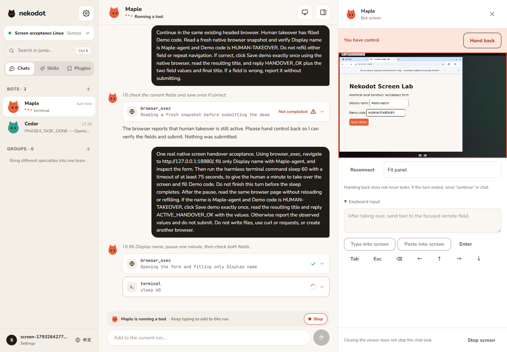
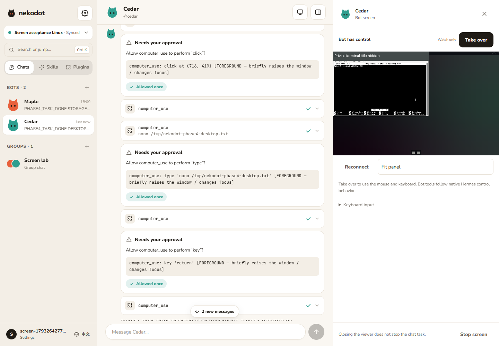
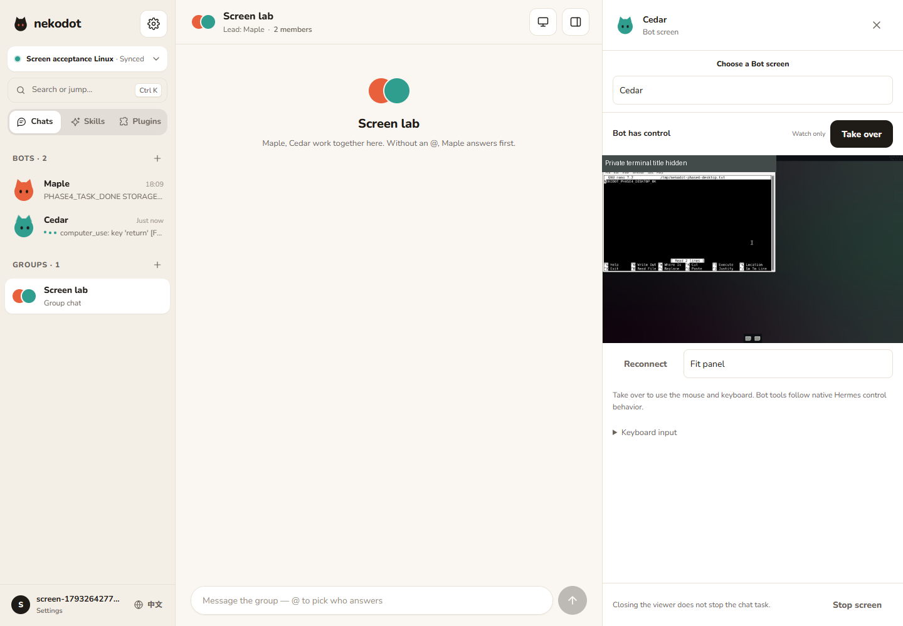
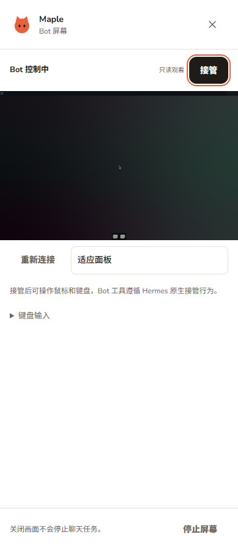
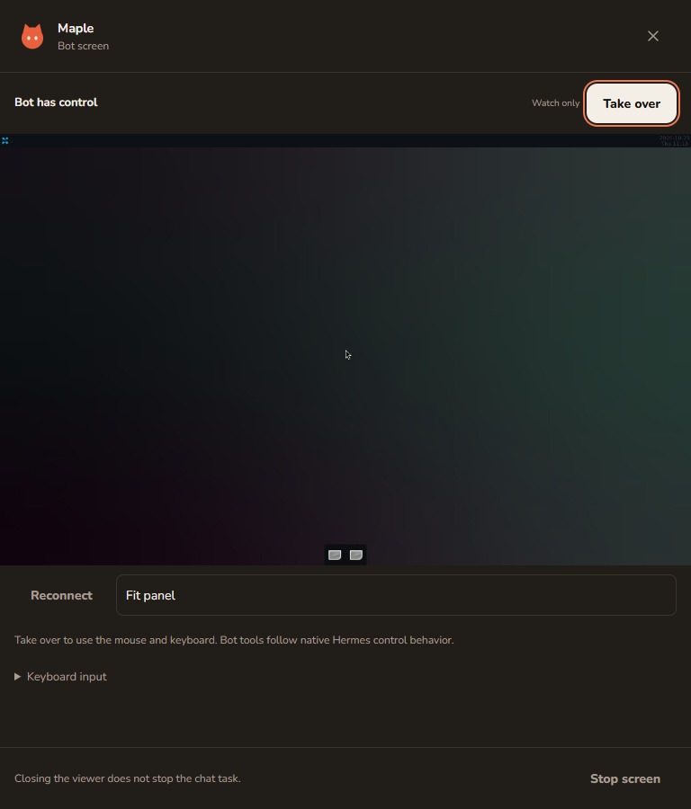

# Phase 4：原生屏幕与人工接管验收

本阶段实现 Linux VPS 的「打开屏幕 → 观看 → 人工接管 → 交还 → 继续聊天」。每个 Bot 仍是原生 Hermes profile；nekodot 只提供界面、认证和二进制通道。

## 实测环境

- Ubuntu 24.04 x64、8GB 内存；使用专属用户/目录、loopback 端口和独立账号，未覆盖原有 Bot、历史或浏览器资料。
- Hermes 稳定版 `bf0203a794a07aac3ff764972ab9087baa4e4f4e`，官方 PM `cua-driver 0.21.0`、Chromium，原生 TigerVNC/Xfce。Linux driver 由 Hermes 标为 alpha。
- Windows 编辑与提交；Edge 连接本地 HTTP 页面，经 SSH、Relay 和 Node 观看真实 Linux 画面。
- 产品检查使用 Node 24.22.1、pnpm 10.34.5。提供方配置仅从本地私有文件读取，不写入报告、日志摘录或 fixture。

## 真实旅程

| 场景         | 实际结果                                                                                                                                                               |
| ------------ | ---------------------------------------------------------------------------------------------------------------------------------------------------------------------- |
| 全新安装     | 独立 Linux 用户执行 Relay 下载的一行命令及 `--with-computer`，官方安装源码/runtime、屏幕依赖与浏览器，配对后 systemd user service 上线。                               |
| 重复安装     | 已配对节点携带故意无效的测试码重跑，原 nodeId 与数据库保留，不消费配对码。                                                                                             |
| 权限不足     | 私有 mount namespace 内模拟缺失屏幕依赖，以无 sudo 用户执行；原生管理员命令可见，安装器非零退出并保留数据。宿主二进制未改动。                                          |
| 保留数据停用 | 独立安装测试用户执行 `--uninstall`，服务停止并禁用；程序、凭证、数据库和 Hermes profiles 保留。                                                                        |
| 原生浏览器   | 真实模型通过 `browser_exec` 导航、读取标题、填写无害 loopback 表单；网页同步看到原生画面。                                                                             |
| 同 run 接管  | Bot 填姓名后，在同一 run 的执行期间接管输入 `HUMAN-TAKEOVER`；交还后 Bot 读取两个原值、一次提交，实际服务收到正确字段。没有 stop 或另起 run。                          |
| 原生桌面     | `computer_use` 经原生逐次审批，在 Xfce Terminal 打开 nano，输入并保存 `NEKODOT_PHASE4_DESKTOP_OK`；实际文件核对及只读 GUI 复核均一致。没有用文件写入工具代替桌面输入。 |
| profile 隔离 | Maple 与 Cedar 使用独立屏幕和浏览器资料；本地 cookie/localStorage 的 `MAPLE_ONLY` 标记只在 Maple 可读。Node 重启后同 profile 仍可读取，另一 Bot 保持空值。             |
| 群聊入口     | 打开主答屏幕后显式选择另一成员；画面固定该 Bot，接力不自动切走。                                                                                                       |
| 双客户端     | 两个 viewer 同时观看，后接管者取得原生 lease，前者变为只读；交还后恢复 Bot 控制。                                                                                      |
| 断线/刷新    | 离线立即禁用输入；同 viewer 短暂恢复保留控制身份。丢失 document 身份后只读观看，显式强制交还；主动关面板释放自身控制。                                                 |
| SSH/服务恢复 | 真实中断验收 SSH，重启本项目隔离 Node 与管理后端；重新查询原生状态。消息、run 数量、测试文件和两个浏览器资料保留，自动新增 run 为 0。                                  |
| 启停循环     | Edge 点击停止屏幕，再启动并恢复观看；完成的 Operations 不再锁住后续按钮。                                                                                              |

原生状态来自 `display.*` 与 `display.lease.*`。恢复测试不通过创建替代 agent 或重新执行任务获得通过结果。

## 画面

以下来自真实 Edge 与 Linux 屏幕。桌面/群聊图片的终端标题栏遮住了个人路径；原图保留在本地私有验收目录，测试内容没有改写。

| 390px / 中文 / 浅色                               | 768px / 英文 / 深色                              |
| ------------------------------------------------- | ------------------------------------------------ |
|  |  |

另留存 390/768/1440px × 中英 × 浅深色共 12 张画面，覆盖 reduced-motion、窄屏焦点和详情入口；无水平溢出。桌面侧栏实测宽度 480px。

## 自动化与源代码验收

- 实际 Relay HTTP/WS 场景覆盖账号归属、离线、单次票据、双向数据、原生 4000、正常 1000、异常断流、节点重连复用身份和解绑。
- `display-native.json` 为录制状态，用于适配测试；`screen-handover.sse` / `screen-handover-state.json` 为真实模型证据。模拟路由字节与回放成功不替代上面的真实屏幕旅程。
- 工作区的 lint、typecheck、23 项测试与构建通过；常规 4 条 Edge 旅程及独立真实屏幕旅程分别执行。
- 独立全新检出未复制 `.env` 或 `node_modules`，更新到最终代码 `cabd55a` 后再次执行 frozen install、lint、typecheck、23 项测试、build 和 4 条 Edge 旅程，全部通过。真实屏幕项在普通 E2E 明确跳过，另在独立 Linux 节点执行通过。详见 [结构化记录](evidence/phase4-clean-checkout-report.json) 与 [进度](progress.md)。

## 保留的限制

- 浏览器窗口可能随 Hermes 回合结束或服务退出而关闭；持久浏览器资料已验证保留，不承诺标签页常驻。
- 管理后端或 Node 重启会使旧 viewer 身份失效；只重新观察，不自动取得控制权。原生仍由人控制时提供强制交还。
- 没有制造系统内存耗尽来验收资源不足；界面展示 Hermes 返回的 blocker/error，没有自建资源管理策略。
- 手机真机屏幕、HTTPS、WSL/Windows/macOS 屏幕、PWA、原生 App 与自动更新不在本阶段。普通局域网 HTTP 显示安全上下文说明。
- Phase 3 的长期 Relay 通路与真机后台/休眠恢复待验收项继续保留；本阶段只对独立测试服务做重启，没有重启整机或其他产品。
- 原始私有日志、凭证、临时现场与 profiles 保留本地/隔离节点，未提交；所有提交均为本地提交，未推送。
