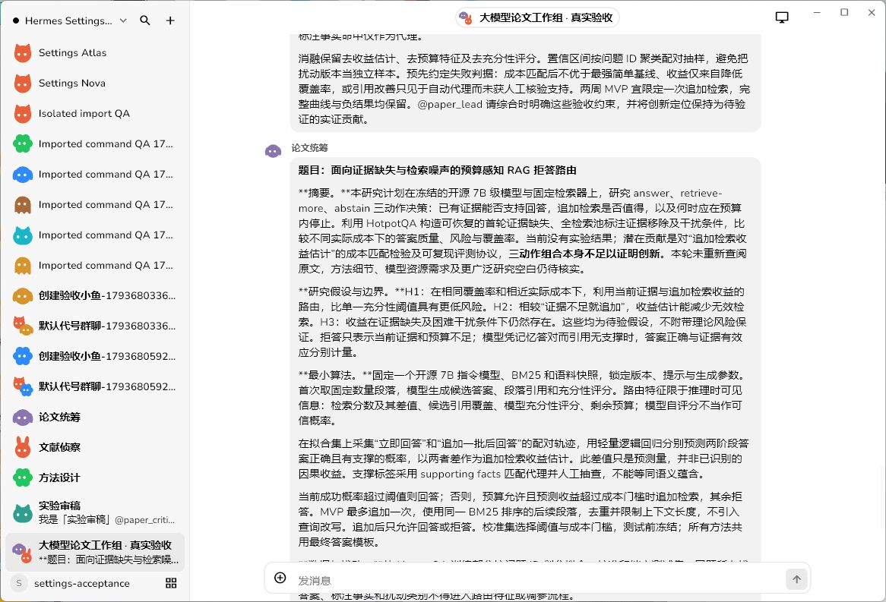
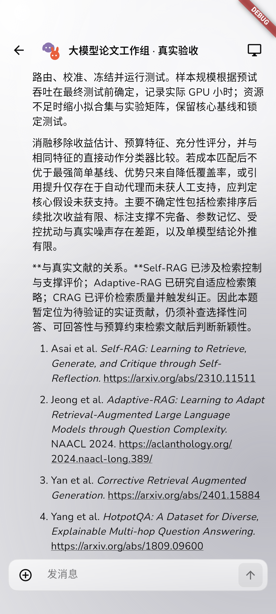

# 代码复查与四 Bot 论文构思真实验收

日期：2026-11-03。没有修改 Hermes 核心，没有部署正式服、push 或删除文件。

## 复查与修复

本轮重点审查 Bot 创建/模型配置、群聊成员与队列、canonical 会话提交和恢复、失败消息、Flutter 编辑器与聊天入口；不是“所有代码没有漏洞”的保证。

1. **待执行成员重复排队**：用户通过 @everyone 排队后，当前 Bot 再提及已经等待的成员，会追加相同成员，消耗额外回合。只对待执行队列去重，仍允许已发言成员再次接力。真实五回合讨论覆盖该情况。
2. **群聊启动失败原因丢失**：原生回合启动前失败时，没有持久保存该 Bot 的失败消息，只显示泛化系统提示。现在保留失败原因，同时继续剩余队列。失效来源场景经过辅助回归；未将人为故障注入正式服。

隔离环境最初使用旧候选包启动，出现 YAML collection 错误；从当前源码重建后恢复。当前源码未复现，未添加多余运行时兼容代码。保留空 secrets 配置回归，避免把旧构建问题包装成新增源码修复。

## 真实环境

- Windows：实际 Flutter 原生候选，使用现有 HomePage、Bot 编辑器、群组编辑器、聊天输入框和真实同步层，不是 WebView 或录制 Hermes。
- 服务：本机 WSL Ubuntu 24.04 的持久隔离 Node/Relay，官方 Hermes **v0.22.5**，模型为现有自定义来源的 **gpt-6.1-sol**。
- Android：固定复用 **NekodotNativePhase3 / emulator-5554**。检查同一组的真实历史同步与阅读，没有重建 Bots、重发论文任务或新建虚拟机。
- 本轮未验 Android 物理真机、生产 VPS、发布包覆盖安装、推送、屏幕接管或完整功能矩阵。

## 实际创建与讨论

群组：**大模型论文工作组 · 真实验收**。

| Bot      | handle       | 模型        | 职责                           |
| -------- | ------------ | ----------- | ------------------------------ |
| 论文统筹 | paper_lead   | gpt-6.1-sol | 收敛问题并综合                 |
| 文献侦察 | paper_lit    | gpt-6.1-sol | 识别文献重叠与待核实项         |
| 方法设计 | paper_method | gpt-6.1-sol | 最小算法与可实现性             |
| 实验审稿 | paper_critic | gpt-6.1-sol | 泄漏、成本、公平基线与失败判据 |

通过 Windows 原生界面逐一创建四个 Bot、填写模型及角色，再勾选四位成员创建群组；四条欢迎消息均由实际模型产生。经原生输入框提交一次任务，实际顺序为：

**统筹 → 文献 → 方法 → 审稿 → 统筹综合**。

首轮统筹提及已排队的文献 Bot，没有产生重复文献回合；审稿再次提及已经执行过的统筹，正确产生最后综合。五条回答全部完成，无额外用户消息或隐藏代写。原生日志记录 **4 次欢迎 + 5 次讨论 = 9 次 API 完成**；未通过模型替换或 fake-Hermes 完成验收。

一条欢迎消息的真实模型延迟约 **413 秒**，超过首轮驱动等待时间；原任务后来正常返回，没有自动重发。测试等待放宽后复用已创建实体与已完成任务。客户端关闭重开及候选 Node 重启后仍为相同五条消息，API 完成数量不增加。

## 论文产物与依据

- 最终构思：[rag-paper-concept.md](research/rag-paper-concept.md)。题目为**面向证据缺失与检索噪声的预算感知 RAG 拒答路由**。
- 全部讨论：[rag-group-discussion.md](research/rag-group-discussion.md)。保留四位 Bot 原始输出及统筹综合。
- 基础文献：Self-RAG、Adaptive-RAG、Corrective Retrieval Augmented Generation、HotpotQA。逐一访问 arXiv / ACL 原始页面，确认标题、作者与可用性，核对摘要层面的对应关系；不是仅检查 URL 形状。
- 研究方案包含冻结 7B 模型、BM25、轻量路由、问题级拟合/校准/测试隔离、证据扰动、成本匹配基线、risk–coverage、消融与失败判据。
- **没有运行论文实验，也没有证明新颖性或性能提升**。Bot 明确指出现有工作重叠，后续须补充选择性问答/预算检索相关文献和实测资源。正文是可实施的研究计划，不是已完成论文。

## 视觉与恢复

Windows 实际观察：四位成员、接力状态、长回答、作者归属与输入区可见，最终无“停止”按钮；Node 重启后恢复连接及历史。Android 真实模拟器读回同一会话的五条结果，消息标识不变、不重发。

早期验收驱动的问题如实记录：Windows integration_test 没有 captureScreenshot 实现，改用实际窗口截图；Android 首轮未设置本机 Relay 的 adb reverse，随后补齐；另修正首帧尚未绘制就寻找列表的驱动时序。这些不算产品测试通过，最终以修正后的真实恢复旅程与窗口观察为准。

## 工程结果

- TypeScript typecheck、ESLint、服务端 **36 文件 / 63 项测试**、Web/Node/Relay/分发 build 通过。
- Flutter analyze 无问题，**18 项辅助测试**通过；真实 Windows/Android 集成恢复旅程通过。
- 本次候选 Windows/Android debug 构建完成；不声称本轮进行了新的 release 构建或全新检出。
- 全仓 Prettier 仍有既有三个文件未通过：docs/side-phase5-command-adapters.md 及两份 docs/evidence/side-phase5-commands-*.json。未擅自格式化其他未提交成果；本次改动限定检查通过。
- 实际模型记录：[research-model-calls.json](evidence/research-model-calls.json)；群聊结果：[research-group-real.json](evidence/research-group-real.json)。只收录脱敏结果，不提交原始私有日志与凭据。

四位 Bot、组与历史保留在 **Hermes Settings QA** 隔离节点；Windows 手工测试候选已打开该群组。正式服账号不自动出现这些隔离验收实体。
