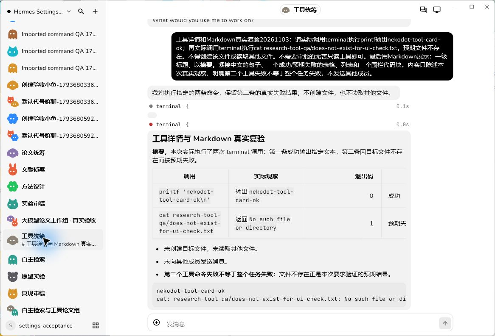
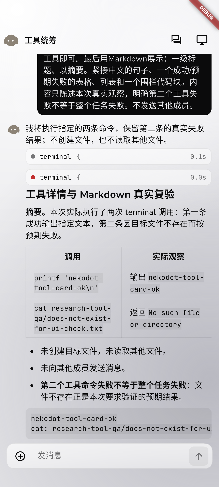
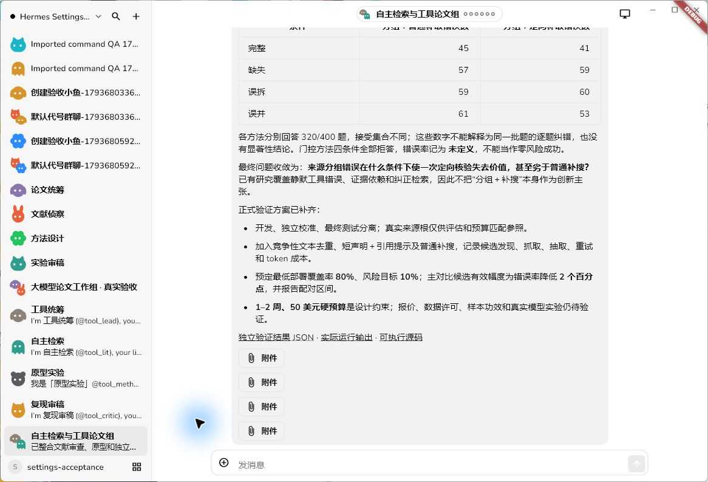
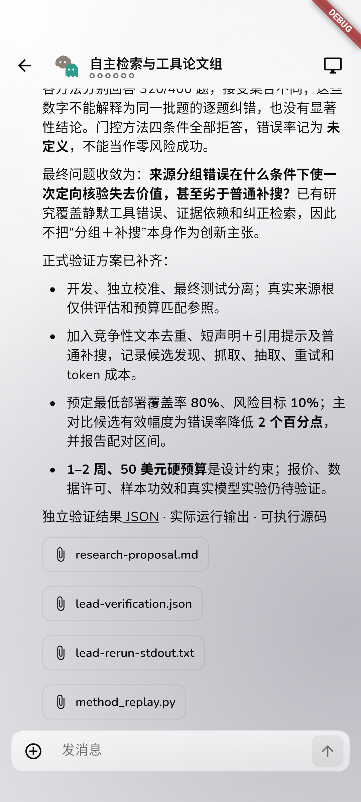
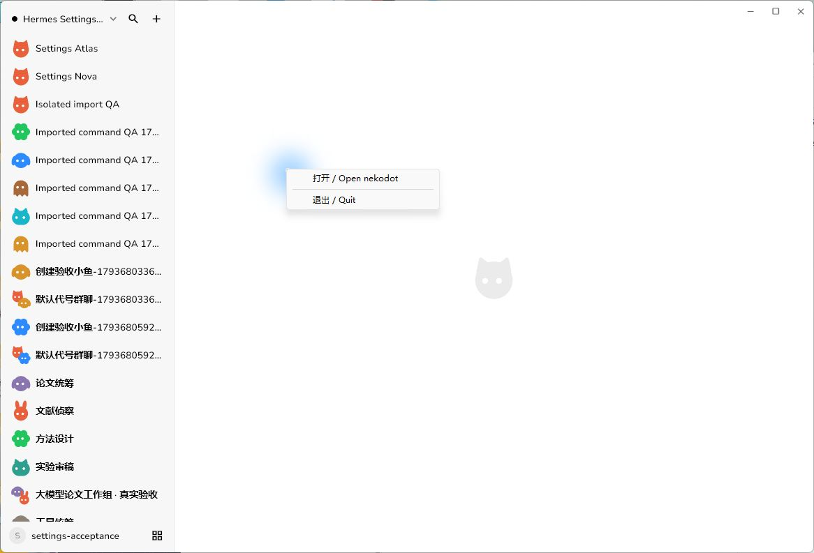

# 自主工具研究、Markdown 与托盘修复验收

日期：2026-11-03。官方 Hermes v0.22.5 + 真实 gpt-6.1-sol；Windows Flutter 候选、固定 NekodotNativePhase3 Android 模拟器、WSL Ubuntu 24.04 隔离 Node/Relay。没有生产部署、push、文件删除或 Hermes 核心修改。

## 纠正上一轮验收

上一轮给 Bot 提供了文献与题目，因此只证明模型讨论，不证明自主研究工具能力。本轮从 Windows 原生 Bot 编辑器创建全新四个 profile，原生群组编辑器组队，输入框只给任务、角色、交付要求与公开资料范围，**没有论文名称、URL、预选题目或方法答案**。

| Bot      | 模型        | 群聊原生工具调用数 | 实际工作                                   |
| -------- | ----------- | -----------------: | ------------------------------------------ |
| 工具统筹 | gpt-6.1-sol |                 15 | 搜索方向、读取原始文献、综合并独立复跑附件 |
| 自主检索 | gpt-6.1-sol |                  8 | 独立检索、原始论文提取、重叠审查           |
| 原型实验 | gpt-6.1-sol |                 11 | 写 Python、运行、修复错误、保存真实结果    |
| 复现审稿 | gpt-6.1-sol |                 10 | 独立复跑、检查结果与文献、指出负面结果     |

共 44 次顶层原生调用；execute_code 内的 web_search/web_extract/terminal 等不额外累加。对应原生 SQLite 工具结果均非空，并有实际生成文件，不以模型“我执行了”的文字为证。五轮群聊完成；4 条模型欢迎另计。Android 读回同一五轮回复，没有重复创建 Bot、发任务或新建模拟器。

## 真实产物与边界

- [研究方案](research/autonomous-tools/research-proposal.md)：来源分组错误下定向核验的失效边界。题目由模型自主选定。
- [原始讨论](research/autonomous-tools/discussion.md)、[文献审查](research/autonomous-tools/lit-review.md)、[复现审查](research/autonomous-tools/critic-review.md)。
- [可执行原型](research/autonomous-tools/method_replay.py)、[真实输出 CSV](research/autonomous-tools/method_summary.csv)、[实验说明](research/autonomous-tools/method-report.md)。
- 独立访问模型检索到的 ACL、arXiv、PVLDB 7 个原始入口：均返回 200，网页题名吻合；不是预先给模型这些地址。细节见 [脱敏证据](evidence/research-autonomous-tools.json)。
- Python 原型实际运行的是 **600 条合成题（200 开发、400 测试）**，不是 LLM 效果实验。缺失与误拆条件下定向补取出现负收益，门控策略全部拒答，团队如实保留；不能声称创新性或论文效果已证。
- 模型自己提出的 50 美元后续研究预算不是本次真实验收的费用限制，也不是用户已确认的研究经费。
- 实际遇到目录不存在和脚本异常，模型创建任务目录、patch 脚本后继续；按具体命令审阅批准 5 次单次审批，未改为全允许。

## 修复与实际显示

1. **Markdown**：继续使用已有 Flutter Markdown 库，统一聊天和会话历史渲染；针对真实输出的中文标点紧邻粗体边界增加解析规则，保留代码块、转义和原始文本。GFM 表格、标题、列表、链接、代码块可正常显示。宽表格用库自带水平滚动，避免手机上每列挤成几个字符。
2. **工具详情**：Hermes 非 verbose 事件已有 args/result，而旧投影只读可选文本，导致展开空白。现在呈现原生参数和结果，保留既有 secret scrub；原生错误/非零退出与整体任务完成分开。Flutter 用工具 error 字段标红。
3. **真实只读复验**：同一 Bot 实际执行 printf 成功、cat 指定不存在测试路径失败。两条真实参数/结果均显示，失败工具标红；模型完成含标题、中文粗体、表格、列表和代码块的回复。Windows 与固定 Android 客户端重新加载均恢复同一结果，未重发任务。

## 工程与未覆盖

### Windows 托盘

显式设置原生 rightClicked 触发器，提供“打开 / Open nekodot”和“退出 / Quit”；菜单及监听对象随 tray 保持有效引用，退出时释放。候选进程中读取到实际 rightClicked 设置。通过私有 QA 入口打开**同一个原生托盘菜单**后，使用 Windows UI 实际点击“退出”，进程结束；随后真实认证 snapshot 仍成功，4 Bot 与群组保留。截图见下。

自动化工具本轮不能定位 Windows 任务栏托盘图标本体，因此**未将“鼠标右击任务栏图标”动作冒充已实测**；已验原生触发器配置、实际菜单与退出，不是仅调用 quit 函数。私有 QA 按钮不进入产品代码。

TypeScript、限定 ESLint、36 文件64项服务端辅助测试、Flutter analyze 与20项辅助测试通过。Windows/Android 原生 debug 候选构建和上述真实旅程通过；不是新 release 包发布。驱动初期异步 snapshot 等待、输入后未 pump、工具完成状态断言错误均修正，失败日志保留私有现场，不隐藏。

Android 物理真机、生产 VPS、全主题矩阵和完整论文实验本轮未验。旧历史中已经丢失的工具详情不伪造补写；新增和实际恢复的原生事件正常显示。
