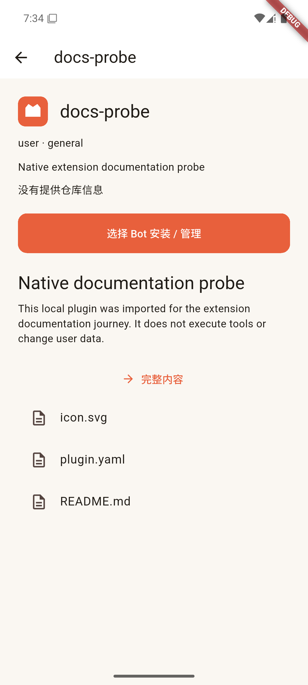
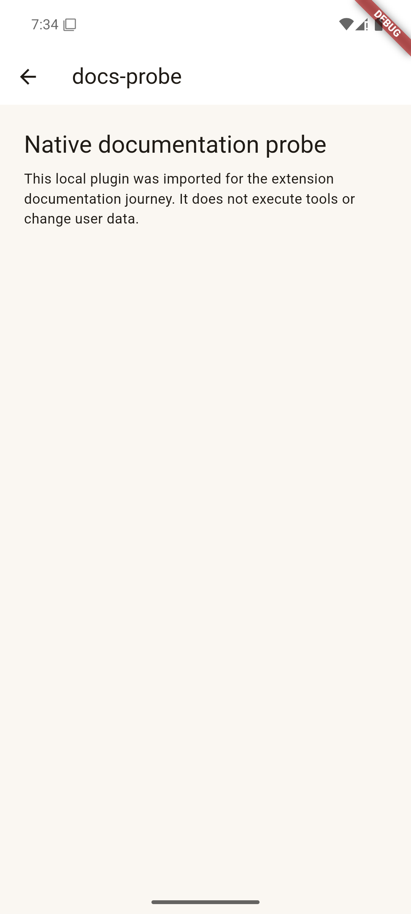
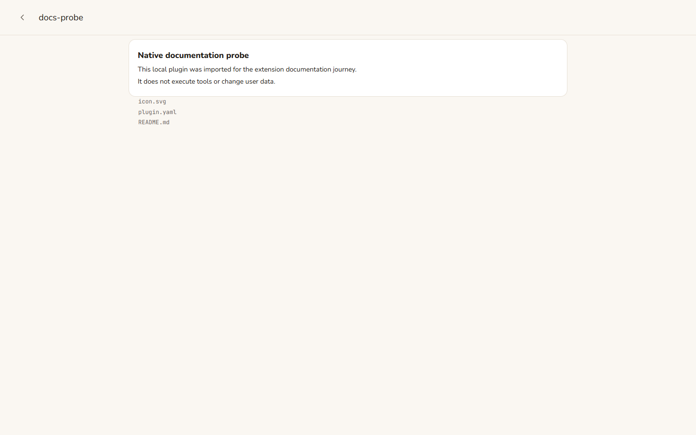

# Side Phase 3：扩展说明与原生交互

## 已实现

- Skills / 插件协议明确区分种类、稳定标识与显示名称。插件正文不再错误地调用技能接口；已安装内容明确指定所属 Bot profile。
- 简介直接显示实际 `SKILL.md` / README 及文件列表。完整内容进入左推的独立页面，左上角返回；返回保留列表筛选和位置。
- 仓库链接取自原生目录或包内元数据，没有提供时明确说明。未安装 GitHub 插件按原生 `repo/subdir` 读取仓库说明；请求失败展示错误，不以简介拼装正文。
- 图标支持原生 HTTPS、包内图片 / SVG 和简短文字图标；没有资源时使用统一类别图标。包内缺失图片不影响整个目录加载。
- Flutter 增加 Windows 完整目录导入，保留配套文件；Android 使用文件 / ZIP。导入仍走既有认证分块上传与 Hermes profile 安装入口。
- Web 搜索高亮改为 80ms tween，reduced-motion 直接切换；Flutter 列表已有 80ms 选中反馈，输入框使用自动增高。

## 真实管理接口

在隔离 WSL Ubuntu 24.04 的独立 home / profile 启动官方 gateway 与 `hermes serve`，未修改既有 profile 或 Hermes 核心。

实际调用：

```text
plugins.manage { action: "list", profile: "nk-docs00" }
GET /api/skills/content?name=claude-code&profile=nk-docs00
GET /api/skills/hub/official?profile=nk-docs00
GET /api/skills/hub/preview?identifier=<原生目录返回值>&profile=nk-docs00
GET /api/fs/list?path=<原生 install_dir>&profile=nk-docs00
GET /api/fs/read-text?path=<README 路径>&profile=nk-docs00
```

通过产品 Node 适配器再次读取，README 与技能正文和原生响应逐项一致，本地 SVG 实际返回图片数据。证据：`evidence/side-phase3-extension-native.json`。实际录制、脱敏后的响应在 `fixtures/extensions-native.json`，原始临时环境保留。

本轮发现官方可选目录不包含所有已安装内置技能，不能把显示名称或自己拼出的标识当成可查询的官方条目。

## 原生与浏览器旅程

- Edge：真实 Node / Relay + 录制管理接口，验证说明自动展示、真实仓库链接、无仓库说明、图标、独立正文 / 返回、按 Bot 停用和 390 / 768 / 1440px 布局。1 项旅程通过。
- Android 独立模拟器：真实 RPC 连接隔离 Node / Relay，搜索插件 → 说明与 SVG → 完整内容 → 返回详情 → 返回筛选列表，通过。此项是管理响应回放，不声称进行了新的模型或真机验收。
- 原生旅程复现并修复两个问题：公共刷新回调返回 Future 导致 `setState` 断言；客户端关闭后 WebSocket 回调继续通知已释放对象。修复后完整返回与连接清理通过。
- Flutter 账号 / 扩展 widget 共 2 项通过；服务端 lint / typecheck / build、16 文件 / 28 项测试通过，不代替上述实际设备旅程。







可选本地回放入口：`tests/support/native-replay.ts`；它只用于测试，不进入产品运行链路。Android debug 仅允许 loopback 测试 HTTP，release 保持禁止明文连接。测试 APK 带有临时 QA 配置，不分发。

## 仍待验收

- Windows 原生文件 / 目录选择器实际导入、Android 系统文件选择器及插件配置页面完整旅程。
- 原生长文、深色、中英与更多窗口尺寸，以及真机交互；Web 响应式结果不等同原生真机结果。
- 新客户端未替换线上产品，服务未部署，安装包未发布。多授权、共享用户记忆、欢迎回合及真实推送等其他模块仍按阶段记录推进。
