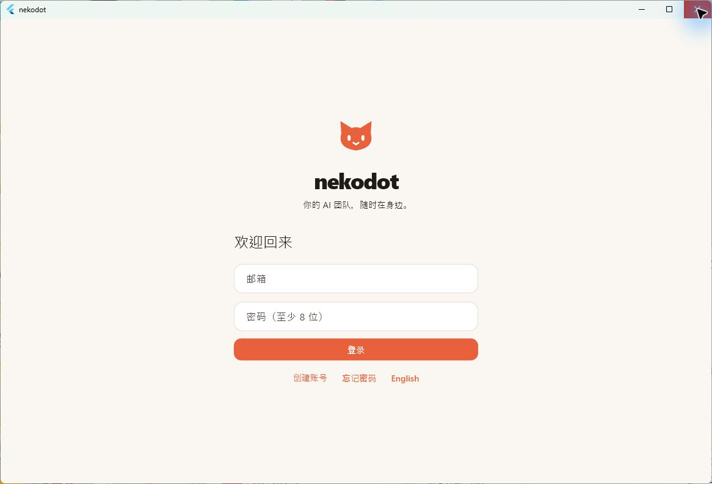
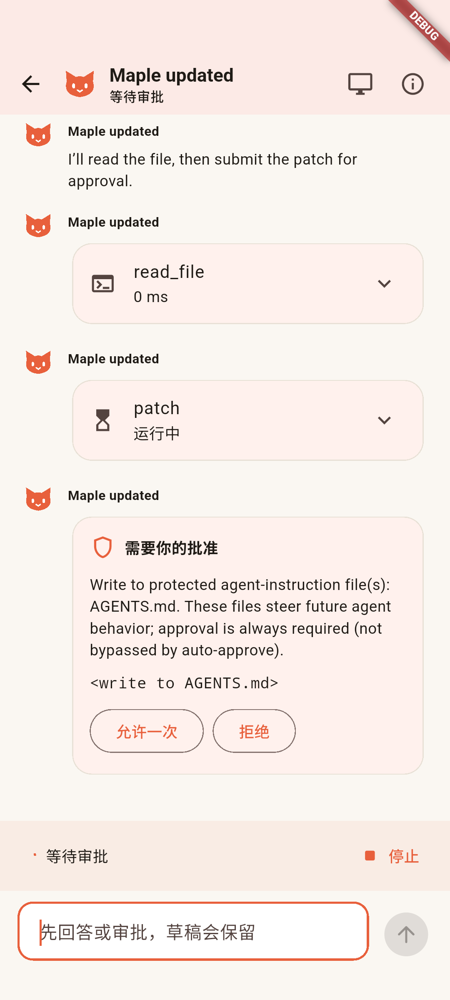
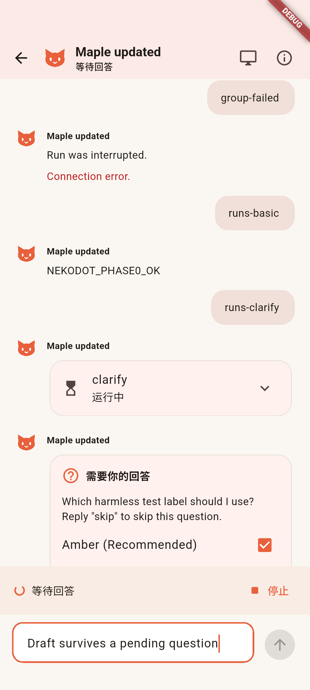
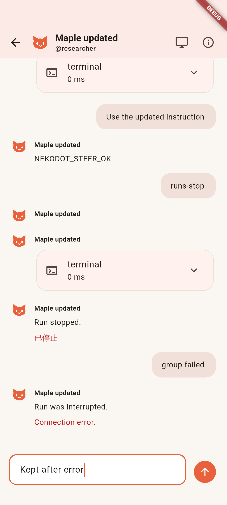
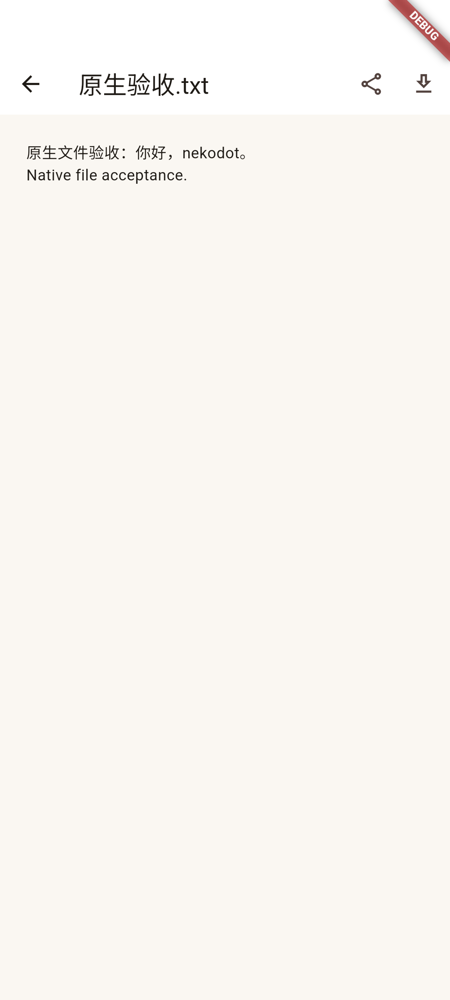
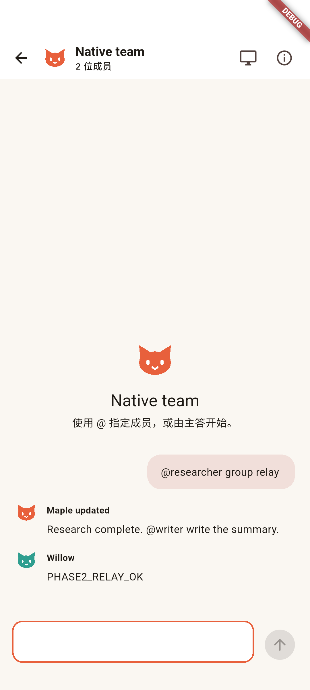

# Side Phase 3：原生客户端产品旅程与候选安装包

本模块补齐 Flutter 私聊、群聊和 Windows 安装器的实际旅程。它是本地候选验收，**不是整个 Side Phase 3 完成，也不是 0.2.0 发布**；线上服务、官网和已发布 Tauri 包保持不变。

## 实现与修复

- 编辑 Bot 先读取该 profile 的实际审批模式，读取完成才允许保存；改名、头像和模型不再把原生 smart/off 审批意外覆盖为 manual。详情随节点的 Bot 更新立即刷新。
- 发送确认只清空仍等于本次发送内容的输入；请求返回前已经写下的下一条草稿保留。消息与提问卡以消息 ID 保持组件身份，重连不会清掉已选答案。
- 会话列表展示连接与同步错误，支持显式重连；80ms 悬停反馈遵循 reduced-motion。修复 Windows 实际运行复现的 ListTile 缺失 Material 祖先断言。
- 文件页缓存当前下载，提供忙碌、错误及保存成功状态；系统保存传递 MIME，系统分享使用 `share_plus`。正文仍通过已认证的产品文件通道取得，不新增离线正文副本。
- Windows 保留单实例、托盘和窗口尺寸。第二次启动按 Flutter 主窗口 class 定位，避免误选托盘辅助窗口；恢复时触发 Flutter 重绘，解决隐藏后恢复白屏。首帧显示保留 Dart 已恢复的最大化状态，不再用 `SW_SHOWNORMAL` 重置。
- 新增每用户 NSIS 安装器，带开始菜单、MIT 文本和 app-local 官方 MSVC runtime，不依赖开发仓库。旧 Tauri 程序及注册信息保留，未执行卸载。
- `native:windows` 生成 EXE；`native:android` 生成既有产品签名 APK。Android 使用 Flutter 官方 ABI 分包，避免第三方依赖的其他架构库让 arm64 包被误判为可在 x64/arm32 运行。

## 已实际完成的旅程

### Windows 与 Android 原生 UI 回放

入口为 `apps/native/integration_test/product_journey_test.dart`；服务为 `tests/support/native-replay.ts --journey`。使用产品 Node、Relay 和真实 Hermes 录制资料，**本轮没有以回放冒充新的真实模型验收**。测试登录用 HTTP 取得隔离账号凭证，不写当前用户的安全存储；它不是邮箱/密码输入页或外部邮件验收。

Windows 官方 `flutter drive` 与 Android 独立 API 35 x64 模拟器的官方 Dart driver 均返回 `All tests passed`，覆盖：

1. 改名后仍为 smart 审批，详情与会话名称即时更新。
2. 发送中继续写草稿、等待提问时保留草稿和已选项、重连后回答。
3. 工具审批允许与拒绝；同一 run 原生 steer，实际回放工具开始次数为 1。
4. 停止、显式运行失败、保留已有内容并恢复可发送输入。
5. 中文文本通过产品文件路由下载和预览。
6. 通过表单建两成员群组、@ 选择、两个 profile 接力；重连后消息 ID 不重复。群聊沿用各 Bot 的已有私聊 session，以保留该 Bot 原生上下文。

文件为明确标注的合成传输样本，不是模型生成附件。Windows 另用真实系统保存对话框保存中文文件，读回内容一致。Android 系统分享/保存和真机软键盘未在本轮标记通过。

### Windows 安装与宿主

- 安装到独立测试目录、重复覆盖安装、开始菜单、版本和 app-local runtime 均核对通过；旧 Tauri 安装仍在。
- 关闭到托盘后进程保留；再次启动恢复同一 PID、同一主窗口，只有一个实例；实际画面恢复正常。
- 用户已手动处理“开启任务通知”提示。这不等于 Windows toast 或 Android 真机推送验收。
- 测试使用现有 Windows 用户和隔离程序目录，**不是干净用户/干净系统安装**。未执行卸载，也未将保留数据的卸载标记通过。

### 工程与独立源码目录

- 独立源码目录不共享工作区 `node_modules` 或 Flutter `.dart_tool`；SDK、Pub/Cargo 下载缓存复用本机已有安装。
- Node 24 frozen install、lint、typecheck、19 文件 / 31 项测试、build 通过。
- 完整 Edge 最终重跑为 **6 通过 / 1 跳过**；真实 Linux 屏幕项缺少本轮现场，跳过不是通过。
- Flutter 锁定依赖安装、analyze 和 4 项 widget 场景通过；双端 release 构建结果见同名机器记录。
- 原生页面和 RFB 均由 Flutter/Rust 绘制，不引入 WebView、另一套 agent 或 Hermes 核心补丁。

## 构建与候选包

```sh
pnpm native:analyze
pnpm native:test
pnpm native:windows
pnpm native:android --signing <private-signing.json> --firebase <google-services.json>
```

默认使用产品 HTTPS 地址。模型配置、SMTP、签名和 Firebase 私有文件不进入 Git；用于本地回放的账号 defines 不进入以上 release 包。

| 候选          | 位置                                            | 说明                                   |
| ------------- | ----------------------------------------------- | -------------------------------------- |
| Windows x64   | `dist/native/nekodot_0.2.0_x64-setup.exe`       | 未作 Authenticode 签名，不伪造发布者   |
| Android arm64 | `dist/native/nekodot_0.2.0+4_android-arm64.apk` | 既有产品签名；minSdk 29 / targetSdk 36 |

Flutter 工程版本为 `0.2.0+4`。官方 ABI 分包使 arm64 APK 的实际 versionCode 为 **2004**；包中只含 arm64 native libraries。模拟器旅程使用 x64 debug 证书包，不与 arm64 发布候选混称；未为覆盖安装而卸载或清空模拟器数据。

## 截图

以下为本模块实际 Flutter 画面。Android 图的 DEBUG 标识来自测试构建；不是已分发安装包或真机照片。













## 重试记录与保留现场

- 工作区首次 Edge 因既有截图被占用失败；独立源码首次整套 Edge 在群聊测试收尾超时。单独群聊重跑通过，随后完整 `--workers=2` 重跑为 6 通过 / 1 跳过，未修改产品或原测试以绕过断言。
- Android 旧的 `flutter drive` 启动曾遇 VM/ADB 转发中断；最终从当前 QA 进程取得 VM URL，由官方 driver 附着同一进程完成测试。产品 HTTPS 设置未为此放宽。
- Windows 带系统保存的长旅程曾被 Esc/连接中断；文件实际保存已单独核对，完整无系统对话框旅程另通过。不将长时间开着系统对话框的网络恢复标记通过。
- Windows driver 有 integration_test plugin 警告，但官方 driver 最后明确返回成功；原始日志保留，不隐藏警告。
- 私有原始日志与安装现场留在 `.runtime/side-phase-3/`；公共机器记录为 `docs/evidence/side-phase3-native-product.json`。没有删除历史截图、profiles 或验收现场。

## 仍待完成

- 外部邮件密码重置/旧账号补验及完整账号安全复测、生产代理来源 IP 验证。
- Android 真机安装、软键盘/网络切换/锁屏/后台权限与 FCM；Windows toast 完整旅程。
- Skills/插件系统选择器、导入及真实安装完整链路；原生 self-improvement 审核到共享 USER 同步。
- 全原生页面中英、浅深色、390/768/1440、桌面缩放与 reduced-motion 完整矩阵。
- 干净 Windows 用户安装、授权后的卸载验收、实际托盘菜单“退出”操作。

此前真实 Codex 授权、自定义 API、共享记忆与原生屏幕闭环见各模块报告，不要求重复授权。本模块只本地提交，不部署、上传、push 或切换旧产品构建。
