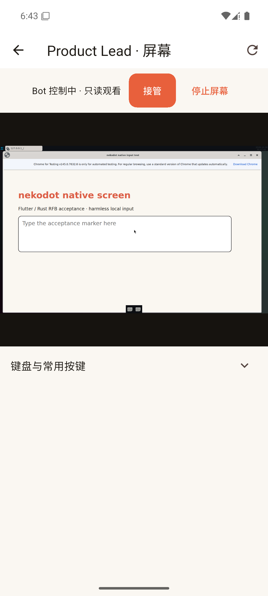
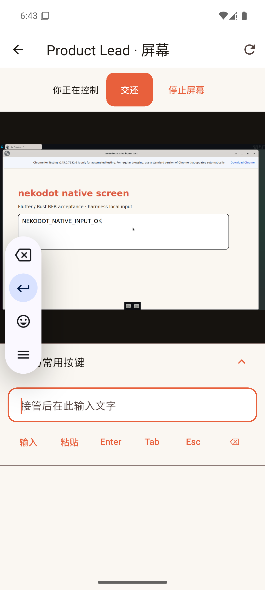

# Flutter 原生客户端：基础闭环

本页只记录已实际验证的基础，不表示 0.2.0 已发布或整个客户端迁移完成。

## 实现

- `apps/native` 使用 Flutter 绘制页面，不加载 HTML/WebView；直接连接现有 HTTPS/WSS Relay。
- Windows / Android 共用登录、节点、聊天和同步数据层；正文只来自 Node，草稿仅在进程中保留。登录凭据使用系统安全存储。
- 屏幕使用 `vnc-rs` 解码、`flutter_rust_bridge` 传递帧、Flutter `RawImage` 显示。继续使用现有屏幕票据和 Hermes 原生控制权，不新增屏幕服务器或 agent 引擎。
- RFB 事件立即消费，帧合并发布；修复库的有界事件通道积压造成画面只显示部分区域的问题。TLS 使用受信任根证书，未关闭证书验证。
- Android 页面返回聊天、会话列表，首页才进入后台；Windows 保留托盘、单实例和窗口尺寸。
- 构建入口是 `scripts/flutter.mjs` 与 `scripts/build-native.mjs`。SDK、签名、Firebase 配置仅在本地私有目录使用；正常 release 不含测试账号的 Dart defines。

## 2026-10-30 实际结果

| 项目                         | 结果                                                             |
| ---------------------------- | ---------------------------------------------------------------- |
| Flutter analyze              | 通过                                                             |
| 可滚动账号表单 widget 场景   | 通过，1 项                                                       |
| Windows x64 release          | VS 2022 更新后构建通过，未做干净用户安装验收                     |
| Android arm64 signed release | 使用既有签名构建通过，0.2.0+3，未发布                            |
| 独立 Android 模拟器登录      | 真实 HTTPS 账号通过                                              |
| 新流式回复                   | 新消息 ID、`streaming`、最终 `NEKODOT_NATIVE_LIVE_OK` 均核对通过 |
| 原生屏幕                     | 完整画面、默认只读、接管、交还通过                               |
| 原生输入                     | 实际远端表单保存 `NEKODOT_NATIVE_INPUT_OK`，文件读回复核通过     |
| Android 返回                 | 屏幕 → 聊天 → 会话列表通过                                       |

真实旅程：`integration_test/live_journey_test.dart`。只在专用测试设备显式执行；带凭据的测试 APK 不作为安装包分发。
截图是真实 Android 模拟器和 Linux 屏幕，不是 Web 手机尺寸，也不是合成图：

第二张左侧浮动条来自模拟器输入法，不是产品控件。测试表单、浏览器目录与日志保留，未覆盖既有浏览器资料。

## 尚未验收与切换边界

- 多来源授权、模型信息、欢迎回合和扩展元数据已后续接入，分别见 `side-phase-3-providers.md`、`side-phase-3-welcome.md` 与 `side-phase-3-extensions.md`；各项真实模型、回放、模拟器边界按对应报告，不代表全平台验收。共享 USER 记忆仍待实现。
- 原生全部页面、Windows 安装器、Windows 完整操作与通知、Android 真机触摸/后台通知/网络切换仍需逐项验收。
- 当前模拟器 Google Play 服务版本低于 Firebase SDK 要求；没有将 FCM 注册或后台推送标记为通过。
- 既有 Tauri 产品、官网及线上账号服务不替换、不重启；没有上传本地候选包或推送 Git。
