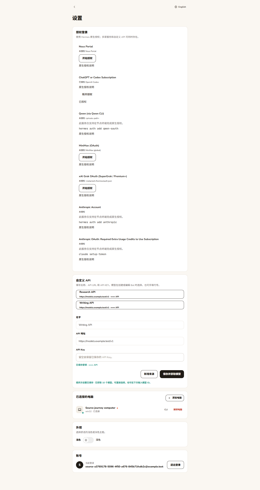
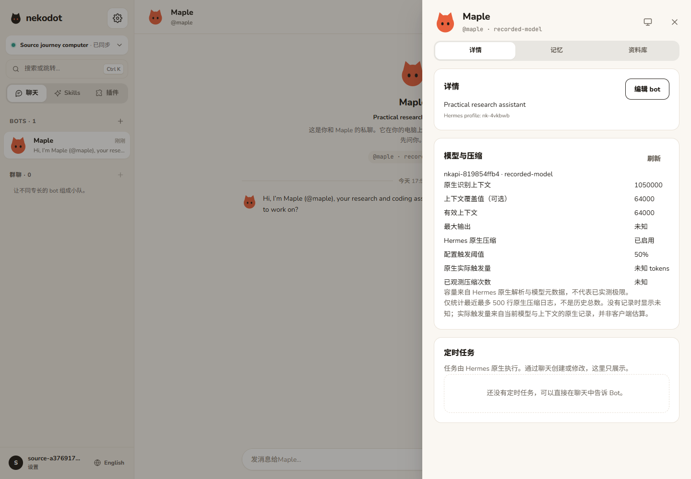
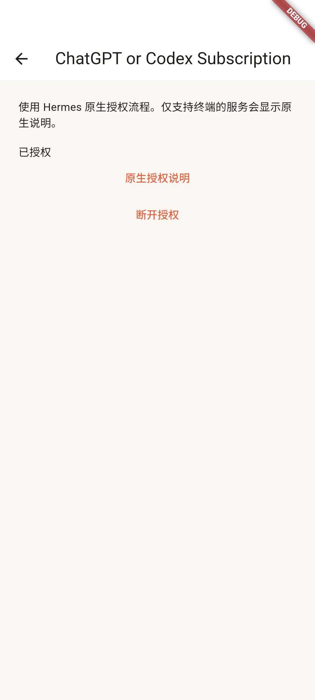
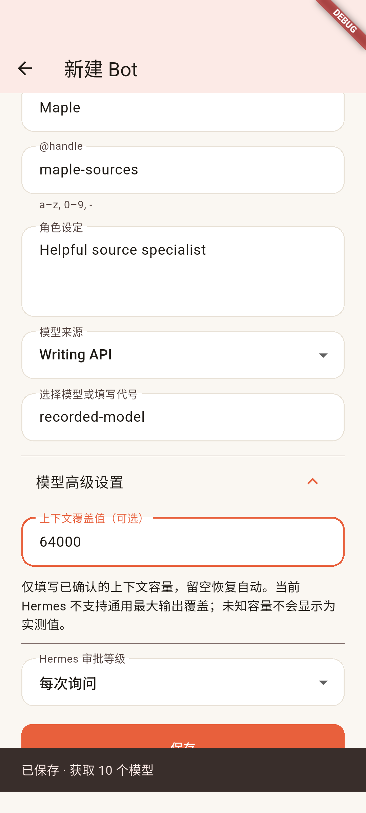
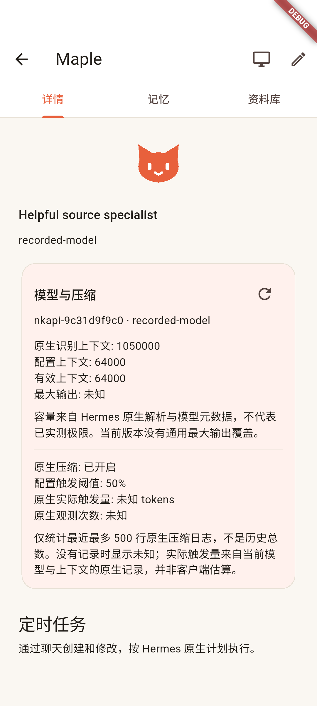

# Side Phase 3 · 原生多授权、自定义 API 与模型信息

本模块用于 0.2.0 候选源码，尚未替换线上产品或发布安装包。

## 使用方式与架构

- 设置分为「授权登录」和「自定义 API」。授权目录、登录状态、设备码、轮询、取消、断开与令牌刷新交给 Hermes；仅支持终端的目录条目明确显示原生命令，不伪造 App 登录入口。
- 自定义 API 填写名称、URL 和 Key，保存后获取模型；设置页不再选择默认模型。支持多个来源共存，Bot 创建/编辑时选择来源与模型，或直接填写模型 ID。
- 一个 Bot 仍对应一个 Hermes profile。`Providers` 只负责来源引用、原生配置与模型信息，不参与工具、审批、记忆、压缩或 agent 执行。
- 自定义来源在项目 root 的原生 `providers` 配置与 `.env` 保存；目标 profile 只应用其所选来源。Key 更新在下一原生回合前应用，不重建运行中的 agent。OAuth grant 只保留在项目 root，由 Hermes 原生继承及刷新，不复制到多个 profile。
- `providers.list/set/authorize`、`models.options/info` 复用既有 Node RPC。旧的 `providers.get` 与单一全节点提供方写入路径退出产品代码，没有双协议或旧逻辑 fallback。已有 profile 的原生路由及历史不被重写，用户显式选择来源后才更改其配置。

## 与实际安装版本对齐

接入前使用隔离 WSL Ubuntu 24.04 的官方 PM runtime，实际调用 `/api/providers/oauth`、`/api/providers/custom-endpoints`、`/api/config`、`/api/env`、`/api/model/options`、`/api/model/set`、`/api/model/info` 与原生压缩日志接口。

- 当前安装版本的自定义模型目录 `slug` 是裸的原生来源 ID，产品的 `custom:` 前缀仅用于来源引用。按实测 slug 精确匹配，不添加多版本猜测路径。
- 原生设备码轮询成功状态为 **`approved`**，不是 `completed`。Web 和 Flutter 按此结果更新授权状态。
- 上下文与最大输出来自 Hermes resolver / capabilities。原生没有可靠值时显示「未知」，不拿模型名称猜数值，也不把元数据冒充压力测试上限。
- 当前安装版本没有通用的最大输出覆盖字段，因此不提供虚构的覆盖控件。上下文覆盖写入原生 `model.context_length`，留空恢复自动识别。
- 原生 resolver 与原生 capabilities 的目录上下文可能不同；有效上下文直接采用 Hermes 返回值，不在客户端重新裁决。
- 压缩由 Hermes 执行。页面显示配置阈值、实际记录中的生效阈值及最近日志中已提交的次数；无记录显示「未知」，不显示为零。最多读取 500 行日志，不声称是终身总数。

## 真实模型结果

入口：`scripts/spike-providers.ts --compression`、`scripts/spike-authorization.ts`。使用项目已有本地模型配置；真实调用不进入日常自动化。

| 场景           | 实际结果                                                                                                                                                                                              |
| -------------- | ----------------------------------------------------------------------------------------------------------------------------------------------------------------------------------------------------- |
| 两个自定义来源 | 两个独立命名/配置的来源，各取得 10 个模型，两个 profile 均完成真实欢迎回合。两者使用同一个已提供 endpoint，不冒充两家不同服务。                                                                       |
| OpenAI Codex   | 用户在官方设备页完成授权，原生状态 `approved`，其 profile 完成真实欢迎回合。随后自定义来源仍完成真实回复。                                                                                            |
| Grant 归属     | 项目 root `auth.json` 存在，OAuth profile 的 `auth.json` 不存在，profile 原生授权状态为已登录；没有复制 grant。                                                                                       |
| 后端重启       | Node 与 Hermes 重新启动后仍有三个来源；欢迎消息没有重复，原 OAuth profile 无需再次登录即可完成新回复。                                                                                                |
| 模型容量       | 此次 Codex resolver 返回上下文 272000，capabilities 返回最大输出 128000。自定义来源最大输出未知。以上是原生元数据，不是实测极限。                                                                     |
| 原生压缩       | 64000 上下文的真实会话运行 `/compress`，13 → 7 条消息；命令报告约 45082 → 27233 request tokens。原生 telemetry 的 committed 记录为 35529 → 13572 tokens，实际阈值 54400。两组计数口径不同，分别保留。 |

最初的 `/tmp` 现场在 WSL 重启后被清空。已改为持久隔离目录，并重新跑完自定义来源、用户设备授权、共存及重启验证；最终证据不依赖丢失的现场。没有读取或复制其他应用的授权，亦未修改 Hermes 核心。

脱敏原生记录：

- `fixtures/providers-native.json`
- `fixtures/oauth-codex-native.json`
- `evidence/side-phase3-sources-native.json`
- `evidence/side-phase3-oauth-native.json`

原始模型响应、密钥、endpoint、账号标识、设备码和授权记录仅保留在私有验收目录，不提交。

## 产品旅程与自动化

- Edge：设置中完成录制设备授权、新增两来源、选来源/模型、配置上下文、创建 Bot、欢迎消息、刷新及模型信息；390 / 768 / 1440px 留图。旧私聊、群聊、审批、提问、steer、停止及扩展旅程一起回归。
- Android 专用模拟器：实际 Flutter 页面与真实 Relay/Node 通信，使用 Hermes 录制响应；完成授权状态页、两个自定义来源的保存/目录、Bot 表单选择 Writing API、手填模型与上下文、欢迎消息、重连以及模型详情。没有用 WebView，也没有用 RPC 创建替代表单创建。
- fake-hermes 只在测试中使用。OAuth pending/approved 与模型信息来自真实记录；压缩记录按 profile 显式载入，新 Bot 不借用另一 profile 的压缩历史。回放成功不代替上表真实模型结果。
- Node 覆盖来源、profile 凭据隔离、Key 更新、重启、上下文恢复自动，以及已知/未知容量与原生压缩记录。

### 本轮收尾回归

- Node **24.22.1**：`pnpm lint`、`pnpm typecheck`、`pnpm test`（18 文件 / 30 项）和 `pnpm build` 全部通过。
- 完整 Edge：**5 通过 / 1 跳过**，包含账号、私聊、群聊、扩展与新来源旅程。真实 Linux 屏幕项缺少本轮私有现场，保持跳过，不能视为屏幕验收。
- 首轮暴露私聊测试仍断言旧的单提供方数据库记录；已改为核对 Hermes 来源目录，完整复测通过。一次历史截图写入遇到 Windows 临时 I/O 错误，后续完整运行写入成功，没有添加重试或忽略错误逻辑。
- `flutter analyze`、`flutter test`（2 项）、Windows x64 release 与沿用原签名的 Android arm64 release 均通过。原生表单与重连旅程来自专用 Android 模拟器，截图已实际检查。
- Vite 分包大小与 Firebase 插件未来 Kotlin 工具链兼容性有非阻断提醒；未为本模块顺带升级工具链或依赖。
- 机器可读结果：`evidence/side-phase3-providers-verification.json`。这次是现有工作区回归，不冒充全新检出或双端安装验收。

### 截图（录制回放，不是新模型调用截图）

## 边界

- 本模块不代表整个 Side Phase 3 完成；共享用户记忆、原生完整平台旅程、真实通知与其他既有待验收项不被改写。
- Android 结果来自独立模拟器，不是真机。Windows release 构建不等同于干净用户安装或全量原生旅程。
- 本轮没有更新线上 Relay/Node、读取生产聊天资料或分发候选安装包；不 push。真实 Linux 屏幕回归需要对应私有现场，本轮不以回放替代。
