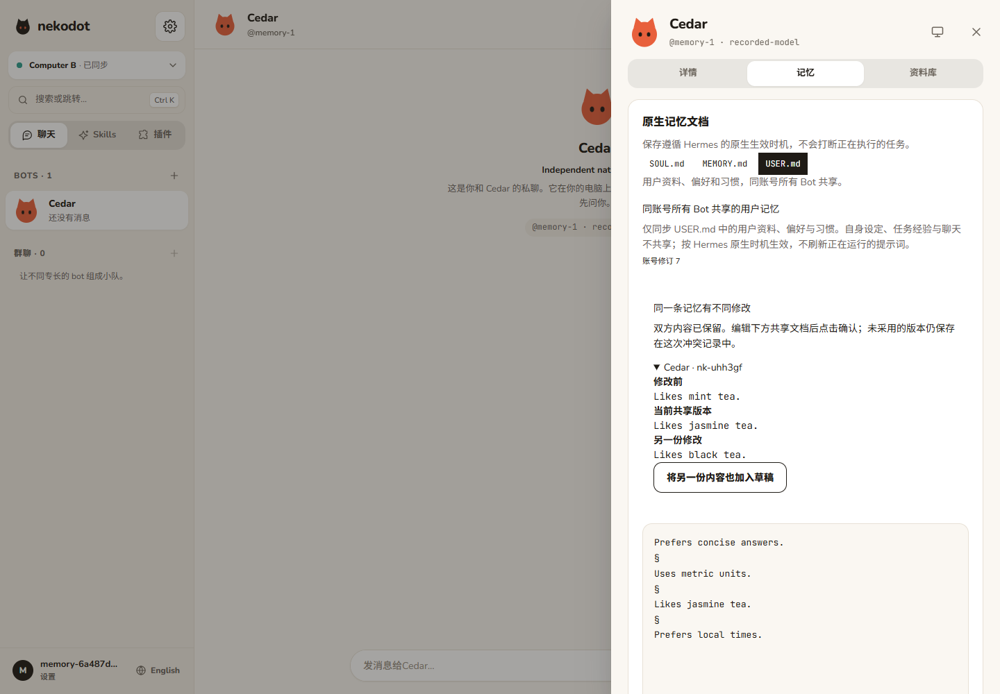
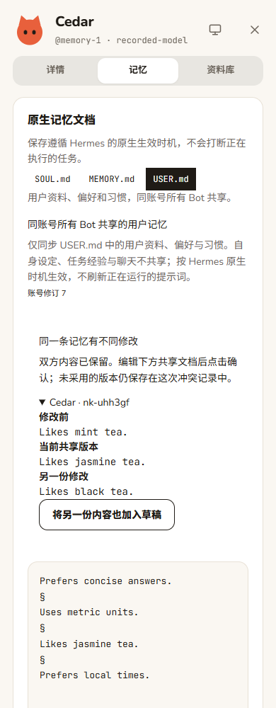
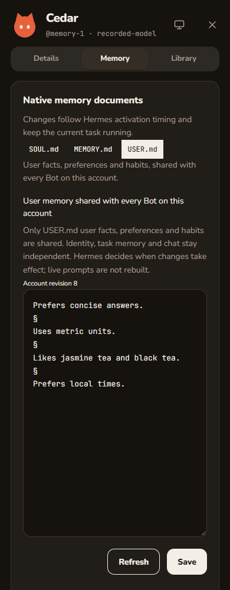
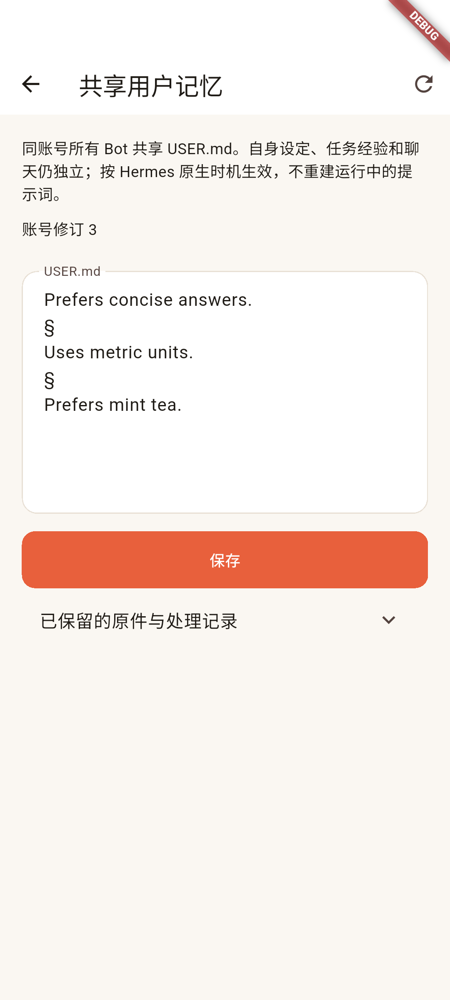
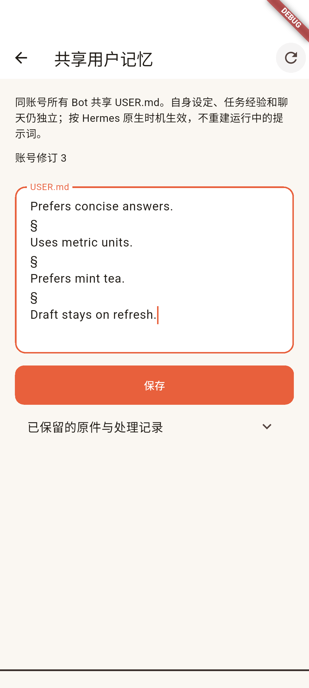

# Side Phase 3 / 同账号共享用户记忆

## 范围与实现

- 只共享 Hermes `memories/USER.md` 中的用户资料、偏好和习惯。`SOUL.md`、`MEMORY.md`、技能和聊天不进入账号记忆库。
- Relay 的 `account_user_memory` 保存账号文档、修订、已有文档原件及冲突记录；账号来自已验证 Node token 的归属，不接受客户端指定账号。
- Node 使用现有出站 WebSocket 的 `memory.user.req/res/changed` 同步，通过官方 profile 文件管理 API 读写实际 `USER.md`。不修改 Hermes 核心，不增加 agent、摘要、CRDT 或提示词热重建。
- 原生条目分隔符使用实查的 `\n§\n`，以 `node-diff3` 合并独立条目修改。相邻的追加与替换不误判为冲突；同一条目不同修改保留原始、当前与传入版本，需用户确认。过期页面保存会明确要求刷新，草稿不丢弃。
- 首次发现已有内容时先汇总，确认前不覆盖 profile。确认后的原件与已处理冲突仍可从页面展开查看。
- 同步发生于节点连接/恢复、原生回合开始前、USER 文件变动、回合成功/失败/停止后，以及原生整理/审核完成时。活动 run 中不向 profile 回写共享版本；继续遵循 Hermes 的缓存和生效时机。
- Web 与 Flutter 的 Bot 记忆页标明共享范围，并提供确认、编辑、刷新、冲突处理和保留记录。普通 `memory.save` 不再接受 `USER.md`，避免绕过账号编辑入口。

## 真实 Hermes / 模型验收

命令源为 `scripts/spike-user-memory.ts`；在独立、持久的 WSL Ubuntu 24.04 环境执行，使用项目 Node 24、官方 PM runtime 和本地现有自定义模型配置。没有覆盖既有 OAuth、profile 或验收目录。

实际结果见 [脱敏记录](evidence/side-phase3-user-memory-native.json)：

1. 两套独立 Node / Hermes home、三个 profile、两个账号经真实 Relay 配对连接。
2. Maple 真实调用原生 `memory` 工具，将无害的温度单位偏好及验证标记写入用户记忆；没有使用固定模型回复。
3. 另一节点 Cedar 的实际文件收到该条目，随后独立原生会话正确回答温度单位和验证标记。
4. 通过原生文件管理 API 修改 USER 文档，文件监听自动传播到另一节点，未手动调用同步代替监听验收。
5. 另一账号 Quartz 未收到这些内容。三个 profile 的自身设定和任务记忆均与本轮开始前一致。
6. 重建 Node 后账号记忆与原生文件保留，消息 ID 不变、没有新增执行。

原始响应、模型配置、日志、SQLite 与现场路径只保留在私有运行目录；此报告不包含凭据、实际 endpoint 或个人路径。

## 自动化与界面

- Node 旅程：两电脑首次原件确认、离线独立修改合并、相同条目冲突、确认解决、旧修订拒绝、重启、其他账号隔离，以及 SOUL / MEMORY 不变。
- Edge 旅程：实际打开 Bot 详情，确认原件，切换电脑，显示并解决冲突，刷新保留草稿，Node 重启后恢复，查看保留原件；390 / 768 / 1440px、中英文、浅深色、reduced-motion 均有实拍。
- 回放环境仅用于自动化界面和路由，和以上真实模型结果分开记录，不冒充真实模型响应。
- Node 24：lint、typecheck、19 文件 / 31 项测试、build 通过。完整 Edge：6 通过，1 项真实 Linux 屏幕因缺少本轮私有现场跳过；独立共享记忆与扩展回归再次 2 项通过。
- Flutter analyze 无问题，既有 2 项测试通过；Windows x64 release 与 Android arm64 签名 release 构建通过。这些是候选构建，不表示安装或真机验收已通过。

### 视觉证据

## 原生旅程与边界

- Android 专用模拟器完成 `integration_test/user_memory_journey_test.dart`：从 Bot 详情进入 USER 编辑、保存、返回首页、另一节点读取共享文档、刷新及重连保留草稿。官方 integration driver 最终返回 `All tests passed`，两张实际原生截图已核对；这是录制管理响应下的原生 UI 旅程，与 WSL 真实模型验收分开。
- 本机初次 VM driver 连接多次中断；续接同一测试进程的官方 driver 后取回完整通过结果及截图，没有重跑服务器任务。没有把最初失败的 `flutter drive` 命令写成一次运行成功；记录见 [界面证据](evidence/side-phase3-user-memory-ui.json)。测试使用模拟器的标准主机访问地址，产品仍使用原有 HTTPS/WSS，不添加运行时降级路径。
- 测试工具因调试签名不匹配自动重装过专用模拟器的测试 App，已向用户报备。未触及真机或服务器数据；后续保持同一调试签名，不进行卸载操作。
- 当前原生版本对 USER 文档的容量、已运行会话的记忆快照及 self-improvement 审核仍由 Hermes 决定；不会声称长文档无限进入提示词，也不会强制当前会话立即采用新记忆。
- 本轮真实验收覆盖聊天原生写入和文件变动；自动 self-improvement 的审核旅程、Android 真机、Windows 干净安装与原生双端长时间跨网络同步仍需最终阶段单独验收。
- 未做全新检出，也未切换线上服务、分发候选包或 push。既有 Phase 3、屏幕和通知未验收项保持原状态。
