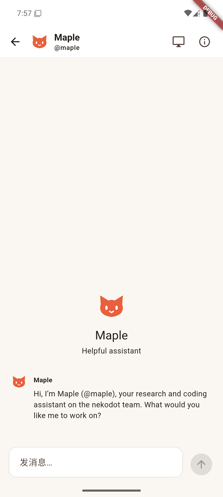
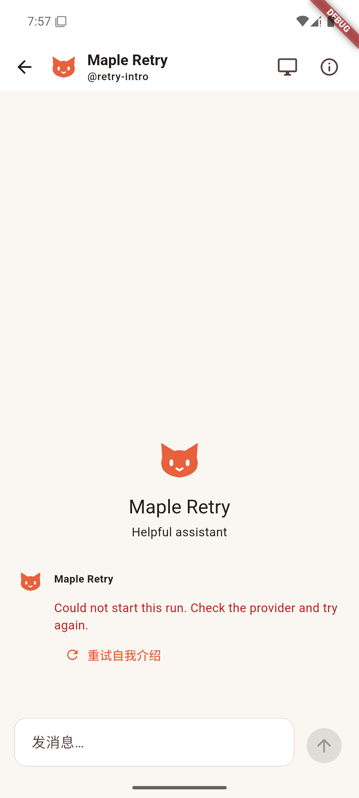

# Bot 原生欢迎回合

## 实现

- `bots.create` 建立对应 Hermes profile 和私聊后，立即保存 Bot 回复占位及运行记录，异步启动同一原生私聊 session 的介绍回合。提示只要求按自身身份介绍并询问下一步任务，正文由模型生成，不写入虚假的用户气泡。
- 沿用现有 Runs API、SSE、停止、steer、通知和恢复流程；初始欢迎请求使用稳定的 `welcome:<botId>` 幂等键。刷新、同步和重连不创建新介绍。
- 失败或用户停止后保留实际状态和错误，Web / Flutter 提供「重试自我介绍」。仅用户点击才创建新的原生回合，不自动重跑。成功的介绍不能再次重试。
- 文本快照与最终 output 保留欢迎标记；正常聊天的后续回复不继承该标记。没有新增 agent 引擎、聊天分支或重试策略。

## 实际验证（2026-10-30）

| 场景                           | 结果                                                         |
| ------------------------------ | ------------------------------------------------------------ |
| 隔离 WSL + 真实自定义模型      | 新 profile 实际介绍自己并询问用户任务，run completed         |
| 真实 Node 重建、snapshot/since | 仍只有一次 createRun、一条 Bot 消息，无用户消息              |
| 真实 session                   | 与该 Bot 的 `nk_dm_<conversationId>` 一致                    |
| Edge 创建 Bot、刷新与后续聊天  | 完整私聊旅程通过；欢迎、提问、审批、steer、停止均可用        |
| Android 模拟器原生页面         | 通过实际 Relay / Node RPC 创建，显示介绍，重连后消息 ID 不变 |
| Android 模拟器失败重试         | 显示失败原因，点击重试后完成；原失败记录保留，无虚假用户消息 |

工程检查：Node 24 下 lint、typecheck、17 文件 / 29 项测试和 build 通过；完整 Edge 回归 4 项通过，真实 Linux 屏幕项因本轮未提供对应私有现场跳过。Flutter analyze 和 2 项 widget 场景通过；欢迎原生设备旅程另外执行通过，不以 widget 测试替代。

真实模型命令：在 WSL 干净非登录 shell 中，使用独立 Node 24 运行构建后的 `scripts/spike-welcome.ts`；数据与日志保留在独立临时目录。脱敏结果为 `evidence/side-phase3-welcome-native.json`，实际 SSE / 状态为 `fixtures/runs-welcome.sse` 和 `fixtures/runs-welcome.state.json`。

自动化使用上述真实录制文本。Edge 与 Android 截图是回放旅程，不冒充第二次真实模型调用；回放可能显示录制时的 Maple 名称。Android 使用专用模拟器，没有覆盖用户真机或分发含测试凭据的 APK。

## 尚未完成

- Flutter 创建表单已为多来源提供方预留新接口；当前本项的 Android 创建验证通过 RPC，而不是声称该表单已经完整可用。多来源模块接入后仍须跑实际创建表单。
- Windows 设备完整旅程、Android 真机及后台欢迎完成通知尚未在本项验收。
- 本项未部署线上服务、未发布构建包、未 push；其他 Side Phase 3 待完成项不因此标记完成。
