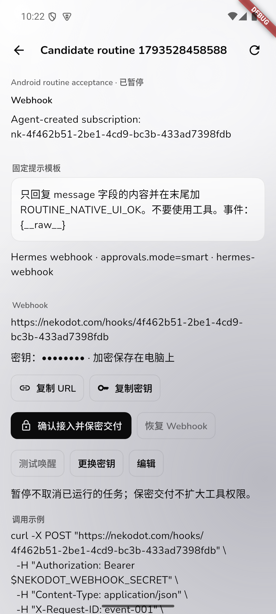
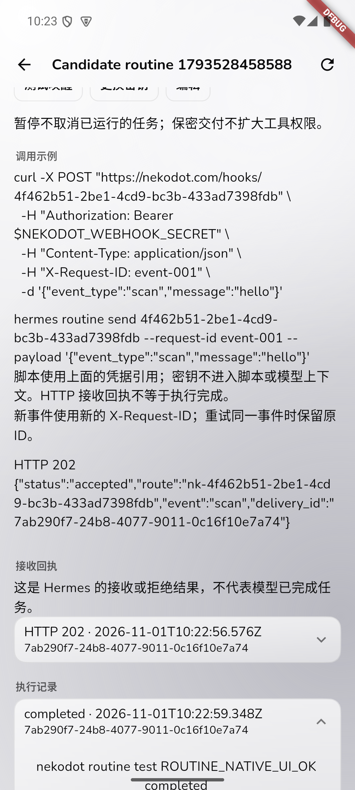
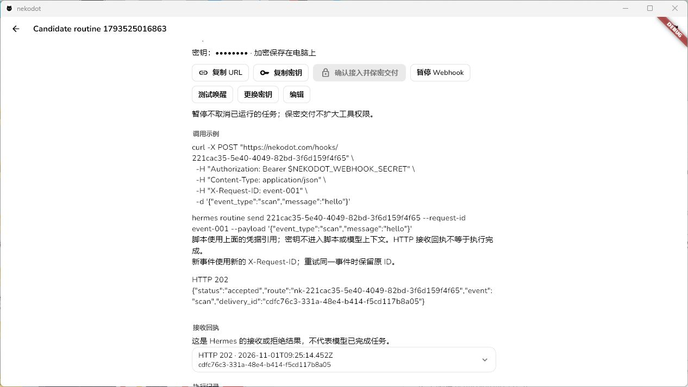
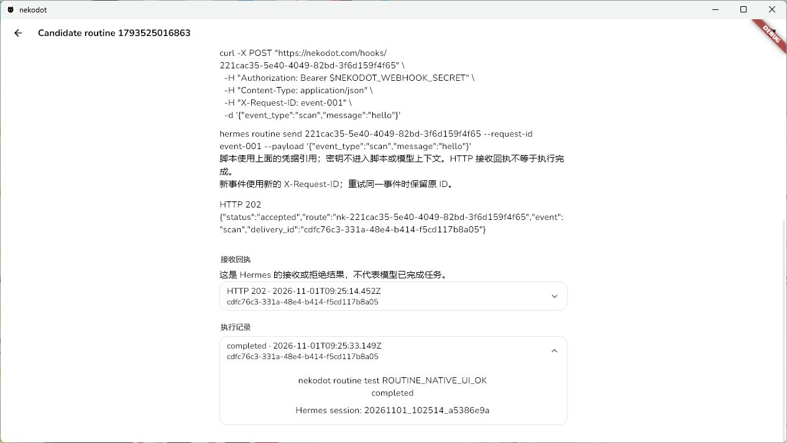

# Side Phase 4 — Webhook 例行任务

状态：Node、Relay、Flutter 候选实现、隔离真实验收及双端候选打包已完成。Android 真机、真实系统通知及完整新页面视觉矩阵仍待验收。未替换产品服务、未发布、未 push。

最终代码基线为 `866ee2de56ebf11d41e075bba37500ceccf04707`，使用不共享依赖的独立检出执行工程检查、原生旅程及构建。脱敏汇总见 [真实验收证据](evidence/side-phase4-routines-real.json)。

## 原生任务与接入

- 一个 Bot 继续对应一个 Hermes profile。纯 webhook 使用共享 gateway 的动态订阅及目标 profile；组合任务关联已有原生 `cron_job`，不复制定时任务。
- Node 内置薄插件和 `nekodot-routines` skill，提供 `hermes routine create/update/list/get/send`。CLI 通过用户私有 Unix socket 联系 Node；不增加公网监听、模型工具循环或调度器。
- 共享 gateway 的 webhook 仅监听 loopback。外部经 HTTPS Relay、现有节点出站 WebSocket、Node 登记路由进入原生 webhook。调用方不能选择 profile、原生 URL 或任务提示。
- Node 使用 AES-256-GCM 保存外部凭据，主密钥在数据库外的私有目录。原生内部凭据独立保存。Relay 仅存入口摘要、节点归属和启用状态，不保存事件正文或模型结果。
- 用户确认前 webhook 禁用；给已有定时任务加 webhook 不会暂停定时部分。聊天卡仅包含任务标识及交付状态。脚本调用 `hermes routine send ID`，不嵌入或输出密钥。
- 原生接收回执与模型执行结果分开。插件通过只读命令读取该 profile 的原生 admission 和持久结果，Node 按原生 session 收录、回投私聊和通知。不再依靠 session hook 判断完成，也没有第二套执行或重试引擎；早期验收 outbox 文件保留原地。
- 下一次私聊输入提供新后台结果及原生 session 引用，不修改已缓存前缀、不重跑原任务、不 steer 当前私聊。
- Relay 的 `hello.ok.publicUrl` 是入口地址来源；Node 可以连接同机 loopback，但展示及 helper 使用公网地址。不保留旧协议双路径。

## 已复现的上游问题及授权修复

真实公网请求在共享 listener 切入目标 profile 后返回 503。durable admission 的 `route_digest()` 再次加载动态路由时，错误读取目标 profile 的订阅文件，而非 listener 所属文件，导致 `RuntimeStoreError: not_found`。

用户已明确允许最小原生修复、单独提交和隔离验收。Hermes 本地提交 `67e4f384b8929926438c9bb014f371d0238a532a`：listener 构造时固定动态订阅文件路径，后续 hot reload 仍读取同一文件。没有改变 agent、权限或任务执行逻辑。

- 新回归先在未修复版本失败；修后 canonical runner 四文件共 13 项通过。
- 官方 `scripts/check` 13 检查通过、health 无问题。
- 只在独立验收 checkout 应用此修复，产品 Hermes 未替换；本功能不能据此宣称已在产品可用。

## 当前真实证据

| 旅程                                | 结果                                                                                                                                   |
| ----------------------------------- | -------------------------------------------------------------------------------------------------------------------------------------- |
| 真实聊天经 skill/CLI 创建纯 webhook | 通过；真实任务卡、默认禁用                                                                                                             |
| 公网跨 profile 接收及真实模型结果   | 修复前 503；隔离原生修复后 202，原生 session 完成并回到私聊                                                                            |
| Windows 候选 App                    | 最终提交的原生集成旅程通过（1 分 33 秒）：建任务、详情、复制、保密交付、公网测试、真实模型完成结果、暂停 403、轮换后旧钥 401及返回聊天 |
| 原生重复 delivery ID                | 相同事件返回 200 `duplicate`，没有增加执行                                                                                             |
| 非选定事件                          | 原生返回 200 `ignored`，未冒充执行完成                                                                                                 |
| 错误密钥、另一账号管理入口          | 公网 401；跨账号 get/credentials/grant/test 全部 forbidden                                                                             |
| 组合任务                            | 同一个原生 cron 的公网 direct 与定时 builtin 执行均真实完成，session 独立、结果一致；验收后暂停定时部分并保留历史                      |
| 模型初始化失败                      | 202 接收后原生 terminal/failed；旧 hook 方案漏报，改为原生持久记录后补回原失败结果，未重新执行；归档 Bot 后入口 403                    |
| Agent helper                        | 真实 Agent 创建并执行 shell 脚本；只用任务引用，公网 202 后原生模型完成；脚本不包含外部密钥                                            |
| 私聊运行时触发                      | 私聊实际执行等待工具时，独立后台任务完成；前台 runId 不变、工具正常完成，没有 steer 或重跑                                             |
| 后续追问                            | 原私聊读取后台结果和原生 session 引用；执行数不增加                                                                                    |
| 原生权限                            | 纯 webhook 无 terminal，真实返回不可用；组合任务实际调用 execute_code，被原生 cron deny 拒绝，工具记录和私聊结果一致                   |
| 暂停正在执行的任务                  | 先接收 202，再暂停入口：后续请求 403，已接受的原执行仍完成，不暗中取消                                                                 |
| 离线与服务恢复                      | Node 离线公网 503；仅重启隔离 Relay、Node 后原 session 和历史保留，无重复结果；旧 delivery ID 仍是 duplicate                           |
| Android                             | 最终提交的模拟器原生旅程通过（3 分 34 秒），覆盖相同真实模型/公网流程、复制、保密交付、暂停、轮换及修正后的滚动几何；无真机结论        |

权限验收不是模型口头声称被拒绝：只读核对原生 session 的 tool 消息，实际工具为 `execute_code`，原生结果包含 `BLOCKED: execute_code`。该回合随后正常报告拒绝，所以原生执行状态是 completed，而不是伪造 failed。

密钥检查覆盖 Node 数据库、私有模型日志、各验收 profile 的 state.db 及 helper 脚本；最终检查 7 个文件、21 个当前凭据，没有明文命中。这是上述实际文件范围的检查结果，不代表所有历史备份均已检查。Relay 不保存 webhook 正文，完整密钥不放入聊天、脚本或报告。

### 实拍与失败记录

- Android 实拍发现任务详情长记录会滚入透明顶栏；仅新任务详情和设置页固定滚动边界，其他页面保持现有改版。原生旅程增加实际视口几何断言，不靠代码截图推断。
- 早期 UI harness 的 offscreen finder、未等待按钮及错误的背景包装分别修正；未将失败轮次写成通过。双端 UI 旅程最终串行运行，避免共享系统剪贴板的相互干扰。
- 最终复测前另两次请求因验收脚本未等待异步复制完成而使用了旧剪贴板，返回 401；已改为等待复制完成提示并核对目标 URL 与密钥，再验证暂停 403、轮换旧钥 401。未放宽产品凭据校验，也未将错误请求计作成功。
- 独立检出最初在构建时磁盘不足，保留原现场后换到另一磁盘的新检出，不清理用户文件。新的 Android 构建遇到 Kotlin 增量缓存错误，单次构建禁用该缓存后继续；补入私有 Firebase 配置，未修改全局 shell。
- Edge 一轮在长旅程 90 秒总时限处失败，另一轮在测试端口处报 `fetch: bad port`；独立重跑完整套件最终 7 通过、1 跳过，未修改产品连接逻辑来掩盖失败。跳过项是需要独立真实屏幕配置的旧屏幕旅程，不是本次 webhook 真实验收。

### 原生候选截图

以下为实际运行的候选客户端实拍，不是 HTML 手机尺寸截图或模型回放。Android 来自模拟器，截图保留测试构建标识；不据此宣称真机或完整视觉矩阵通过。

| Android 任务详情                                                      | Android 原生执行记录                                                    |
| --------------------------------------------------------------------- | ----------------------------------------------------------------------- |
|  |  |

| Windows 接收回执                                                      | Windows 执行完成                                                        |
| --------------------------------------------------------------------- | ----------------------------------------------------------------------- |
|  |  |

[Android 聊天中的任务卡、保密卡与真实后台结果](evidence/side-phase4-android-routine-chat-result.png)。

## 工程检查及交付边界

- 独立检出执行 frozen install、lint、typecheck、29 文件 / 44 项服务端测试及 Node/Relay/Web/distribution build。Flutter frozen pub get、analyze、14 项测试通过；主工作区 15 项包含用户另行修改的指令栏测试，不能混作提交基线。
- Windows release 安装器与 Android arm64 release 构建通过。Windows 安装器没有 Authenticode 发布签名；Android APK 经官方 apksigner 验证 v2 签名有效、1 个签名者，沿用原有私有签名和 `app.nekodot.client` 标识。版本仍为 `0.2.0+5`，不是新发布版本。本轮仅交付本地候选，不自动发布、上传或 push。
- 原生修复只装在 QA Hermes。产品使用本功能前仍需单独安排并授权 Node/Relay 与原生修复部署，不能把隔离成功写成产品已经上线。
- Android 真机、真实系统通知/FCM、本次任务页的完整中英/浅深色/旋转矩阵尚未全部完成；模拟器和现有 Web 回归不能替代这些结果。
- 临时公网 `/hooks/` QA 路由已撤回，仅移除本轮覆盖项并恢复原产品路由。Caddy 配置校验成功，只 reload，未 restart；官网及产品 health 均为 200，原 QA hook 为 404。对照检查的其他容器启动时间不变。QA 数据、日志、profiles、路由备份及构建失败现场全部保留，未重启其他产品或整机。
- 原始响应、凭据和私有配置只保留在隔离现场，不进入 Git。用户既有指令栏、其他 UI 及历史截图改动不纳入本模块提交。

### 本地候选构建产物

- Windows x64 EXE：独立检出的 `dist/native/nekodot_0.2.0_x64-setup.exe`（15,730,535 字节，未做 Authenticode 发布签名）。
- Android arm64 APK：独立检出的 `dist/native/nekodot_0.2.0+5_android-arm64.apk`（34,251,804 字节，原有 release 签名）。
- 这些是独立检出生成的候选包；未覆盖现有公开安装包，也没有以 QA 路由替代产品环境。实际产品启用须另行安排服务端和获授权的原生修复部署。

### 候选使用流程

1. 聊天让 Bot 创建 webhook 例行任务；出现真实任务卡后打开详情。
2. 复制 URL，确认接入并保密交付。Bot 获得任务引用，不会取得明文密钥。
3. Bot 的脚本使用 `hermes routine send ID --request-id EVENT_ID --payload '{"event_type":"scan","message":"hello"}'`；外部自有服务从详情复制密钥并自行配置 Bearer。
4. HTTP 接收回执与执行完成分开查看。结果回到对应 Bot 私聊，可打开原生执行详情；后续追问不会重跑原事件。
