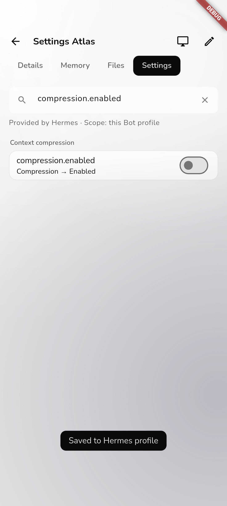

# Side Phase 5：Hermes 设置真实验收

日期：2026-11-02。本记录只覆盖 profile 设置及其 canonical 聊天、恢复通路，不代表 Side Phase 5 全能力完成。

## 实际环境

- Windows Flutter 原生 Debug 候选；Android 使用同一份源码的 API 35 x86_64 Debug 候选，固定复用 `NekodotNativePhase3`，未创建或清空 AVD。
- 客户端版本仍为 `0.2.0+5`。候选包含工作区既有 UI 改动；本轮未覆盖或提交这些无关改动，也未声称是全新检出的发布构建。
- 真实 Node / Relay 运行于隔离的 WSL2 Ubuntu 24.04，保存持久数据；官方 Hermes 源码为干净的 `v0.22.5`。通过官方 PM 入口重新同步运行环境，原 `ruamel.yaml` 缺失阻塞已解决，没有裸 pip 或核心补丁。
- 真实模型：`gpt-6.1-sol`，使用项目已有自定义 API；凭据、端点、私有路径和原始日志不进入报告。
- 验收账号在隔离数据库预置为已验证账号。客户端确实调用密码登录接口，但这不算注册、SMTP 收码或登录页面的重新验收；凭据只留在测试进程内存，不替换系统安全存储中的产品登录。

## 已通过的真实旅程

同一个 `hermes_settings_journey_test.dart` 在实际 Windows 与 Android 宿主运行，未替换 NekodotClient、Node、Relay 或 Hermes。

| 场景                       | 实际结果                                                                                      |
| -------------------------- | --------------------------------------------------------------------------------------------- |
| 会话列表 → Bot 详情 → 设置 | 双端可以进入并搜索真实 schema，读取 908 个字段                                                |
| 保存 `compression.enabled` | 双端真实保存并通过服务器读回确认                                                              |
| profile 隔离               | 修改 Settings Atlas 后，Settings Nova 的压缩设置保持原值                                      |
| 模型字段                   | `model_context_length` 保持只读，显示去 Bot 模型设置修改的说明                                |
| 敏感字段                   | 返回的敏感字段值均为 null，不通过通用编辑器回显凭据                                           |
| select 保存 / 取消 / 清空  | 真实保存 `terminal.vercel_runtime=node24`；选择清空后取消仍为 node24；明确保存清空才写入 null |
| 原生聊天                   | 实际输入框发送无害标记，真实模型流式输出后完成；不是快照或固定欢迎文案冒充回复                |
| 连接恢复                   | 重新连接、snapshot 同步、读取历史后消息标识集合不变，没有再次提交任务                         |

最终 Windows 旅程约 22 秒，Android 模拟器约 26 秒，不包含构建和安装时间。908 是实际读取字段数，不表示已经逐一修改全部字段；数字、复杂 JSON、外部集成及生效时机仍需各自真实场景验证。

## 实际问题及修复

1. **取消清空仍然写入：** Windows 原生候选真实复现：保存 node24 后，选清空再取消，Hermes 读回变成 null。原实现把 dialog 取消与显式 null 混在一起；现在 dialog 用带 value 的结果区分“保存 null”和“没有提交”。双端完整复测通过。
2. **Android 第四个标签被挤出：** 实拍看到 Settings 被截断，中心不可点击。原因是可滚动 TabBar 的默认起始留白占用了四标签区域；仅将该详情栏设为 start 对齐，保留原设计与滚动行为。实际 Android 已能直接进入设置。
3. **验收脚本问题：** 最初在页面过渡结束或输入状态刷新前点击，出现搜索未更新、Send 尚未启用以及对已关闭 dialog 再点击的误报。脚本改为等待真实可点击目标和必要的 UI 刷新，没有为此修改产品模型规则或放宽服务器验证。截图数据也与最终报告合并，避免被 reportData 覆盖。

## 实际重启恢复

- 无活动聊天时，经现有 `hermes.restart` 与 Operations 重启隔离 Hermes gateway / 管理后端。两 Bot 设置和聊天标识不变；随后 canonical `/profile` 实际完成。
- 再停止并启动本轮隔离 Node / Relay，确认其监听端口先关闭、再恢复。复用原数据库、凭据和 profiles，未重新配对、未新建 Bot；12 条历史消息标识及设置保持一致。
- 这是真实进程重启，不是重新创建内存对象；也不是 VPS 整机重启或生产服务部署。

## 工程检查

- Node 24 typecheck、Node bundle、全仓 ESLint / Prettier 通过。原 canonical gateway 两个文件仅补齐格式，无行为更改。
- Vitest 31 文件 / 46 场景通过。与 Android 冷构建并行的首次运行有一项 15 秒超时；结束冷构建后单 worker 全量复测通过，没有提高超时或改测试门槛。
- Flutter analyze 与 16 项 Flutter tests 通过；单元测试只作辅助，不代替上述原生宿主和真实模型结果。
- 双端 Debug 构建及安装成功；本轮未重新发布 EXE / release APK，也未把 Android 模拟器写成真机结果。

## 复跑入口

先准备隔离 Node / Relay、官方 Hermes 和私有验收配置。配置文件包含 `RELAY_URL`、`QA_EMAIL`、`QA_PASSWORD`、`QA_NODE`、`QA_BOT`、`QA_SECOND_BOT`、`QA_CONVERSATION`，不可提交。

```sh
pnpm native:emulator
node scripts/flutter.mjs flutter drive --driver test_driver/live_journey.dart --target integration_test/hermes_settings_journey_test.dart -d windows --dart-define-from-file=../../.runtime/side-phase-5/private/native-settings.json
node scripts/flutter.mjs flutter drive --driver test_driver/live_journey.dart --target integration_test/hermes_settings_journey_test.dart -d emulator-5554 --dart-define-from-file=../../.runtime/side-phase-5/private/native-settings.json
```

ADB serial 以 emulator 入口实际打印的结果为准。若连接隔离 loopback Relay，需要为该 serial 设置对应的 ADB reverse；不改生产 TLS，也不新增一台 AVD。

## 证据与未验边界

- [脱敏结果](evidence/side-phase5-settings-real.json)
- [Windows 设置实拍](evidence/side-phase5-settings-windows.jpg)
- [Android 实际聊天记录](evidence/side-phase5-chat-android.png)



Android 真机、真实推送、完整中英/深浅色/缩放视觉矩阵、生产 VPS 上的匹配版本、全新检出及 release 构建仍未在本轮完成。屏幕、审批/提问、工具、steer/stop、群聊、MCP、子 Agent 等其他 Side Phase 5 能力仍按各自模块继续真实验收。用户数据、既有参考资料和失败现场均保留；没有生产部署、发布或 push。
