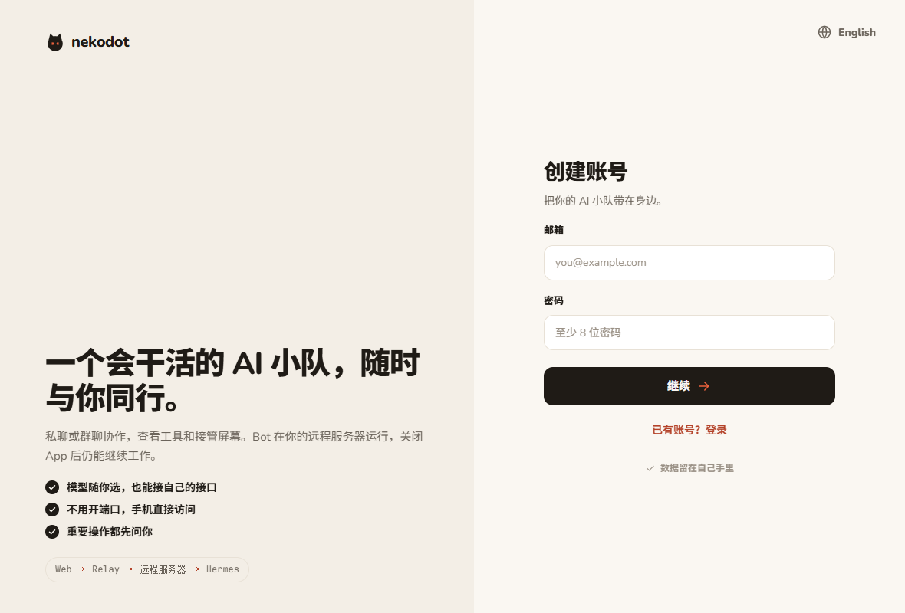
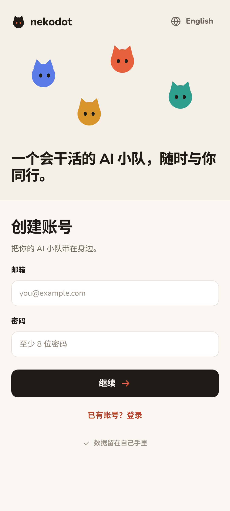

# Side Stage 2：实施结果与待联调项目

日期：2026-10-29。当前状态为**客户端工程与独立产品服务已实现，正式公网及真机交付待联调**。用户确认域名与 Firebase 配置稍后提供，因此本阶段不标记整体完成。

## 已实现

- `apps/client` 使用 Tauri 2 打包现有 React，Windows 与 Android 共用业务代码。资源随包分发，HTTP、业务 WS、文件与屏幕连接使用同一构建时 HTTPS Relay 地址。客户端不运行本地 Node 或 Hermes。
- Windows 配置单实例、窗口状态、关闭留驻托盘和显式退出；Android 配置安全 origin、返回键、生命周期、文件选择/保存/分享与薄的 Firebase 插件。PDF 由共享 PDF.js 组件预览。
- 产品 Relay、SQLite、Node 系统用户、Hermes home 与原测试环境分开。Node 直接连接同机 Relay，Runs、管理、VNC 和 CDP 保持 loopback；Caddy 路由模板已提供，等待域名后启用。
- 通知接入账号设备注册/注销、Firebase Admin 与最小 Node 信号。群聊接力结束只发一条，主动停止不发完成；消息正文、工具参数和密钥不进入通知。
- 正式下载入口已接入，未发布文件时返回 404。没有上传指向测试占位地址的安装包。

## 工程与浏览器

独立检出代码为 `fa6e675`，未复制 `.env`、凭据或原仓库 `node_modules`。使用 Node 24.22.1、pnpm 10.34.5，依赖在该检出内安装。

| 项目                        | 实际结果                                             |
| --------------------------- | ---------------------------------------------------- |
| frozen install              | 通过                                                 |
| lint / typecheck            | 通过                                                 |
| 自动化场景                  | 12 个文件、24 项通过                                 |
| Web、Relay、Node 与分发构建 | 通过                                                 |
| Edge E2E                    | 4 条通过，1 条真实屏幕旅程因未提供私有现场而明确跳过 |
| Android arm64 调试包        | 从独立检出通过标准构建入口生成；实际包含 arm64-v8a   |
| Windows x64 NSIS 调试包     | 工作区与独立检出均构建通过；实际原生宿主已启动检查   |

构建存在 Vite bundle 大小和 Tauri 生成 Android 工程的弃用提示，没有将它们作为功能成功或失败的替代结论。常规回归使用真实 Hermes 录制资料，不调用付费模型；下面的真实产品验收单独执行。

机器结果见 [clean-checkout-report](evidence/side-stage-2-clean-checkout-report.json)。

## 真实产品服务

- 使用授权测试服务器的独立产品环境和现有自定义 API，实际保存提供方、完成一条私聊和两个不同 profile 的群聊回复。
- 实际收到一条私聊完成通知信号及一条群链接力完成信号；没有发送 FCM，不能据此声称后台推送可用。
- 产品 Node 更新/重启后，2 个 Bot、既有历史与 profile 保留，再次真实私聊及群聊成功。Hermes 冷启动完成前节点暂时离线，随后正常连接；未自动重跑既有任务。
- 本轮真实调用通过临时验收通道访问 loopback Relay。该通道只用于验收，不是产品 Node 的依赖，也不是公网 HTTPS 或原生 App 远程旅程。
- 其他产品服务、原测试资料与 Caddy 既有配置保留。脱敏结果见 [server-smoke](evidence/side-stage-2-server-smoke.json)。

## 原生宿主实测

### Windows

实际打开内嵌页面，确认安全上下文、单实例恢复和关闭窗口后进程保留；通过系统另存为保存中文文件，并通过官方 fs 插件写入、读回核对内容。结果见 [windows-qa](evidence/side-stage-2-windows-qa.json)。

### Android 模拟器

在独立 Android 15 / x86_64 模拟器安装与覆盖安装测试包。系统文件选择/保存保留中文名与内容；系统返回进入后台，再次打开保留进程；pause/resume 与无害登录表单输入保留。系统分享 chooser 弹出，未选择外部接收应用。缺少 Firebase 配置时原生接口返回明确错误。

这不是已登录会话的聊天草稿、真机通知、锁屏推送或屏幕触摸验收。结果见 [native-qa](evidence/side-stage-2-android-qa.json)、[lifecycle](evidence/side-stage-2-android-lifecycle.json) 与 [interactions](evidence/side-stage-2-android-interactions.json)。

截图只证明对应原生宿主的实际界面，均未连接正式公网产品域名。

## 正式交付前仍需完成

| 条件 / 项目                   | 当前状态                                                                          |
| ----------------------------- | --------------------------------------------------------------------------------- |
| 产品域名与 DNS                | 用户稍后提供；尚未启用 Caddy 产品站点或验证公网 HTTPS/WSS                         |
| Firebase Android 与服务端文件 | 用户稍后提供；SDK/路由已接入，真实投递未验收                                      |
| Android 发布签名              | 本地私有密钥已生成；配置齐全后构建 arm64 签名 release，不能发布当前调试包代替     |
| Windows 正式安装器            | 等实际域名后构建；未配置 Authenticode 证书，不能宣称发布者已验证                  |
| 原生 App 远程闭环             | 待正式域名；包括私聊、群聊、审批、steer、停止、文件、屏幕及跨端恢复               |
| Android 真机                  | 未连接；安装、通知权限/后台/锁屏、网络切换、软键盘及屏幕接管需独立实测            |
| Windows 安装与系统行为        | 干净用户安装、开始菜单、托盘退出、覆盖安装、缩放/休眠与 Windows 10 仍待正式包旅程 |
| Phase 3 遗留                  | 长期通路及真机恢复项目保持原记录，不因本阶段工程检查通过而关闭                    |

所有模块只做本地 commit，不自动推送。原有未提交 UI 改动、参考资料、profiles、历史、签名资料和验收现场保留；原始日志与凭据不进入 Git。
